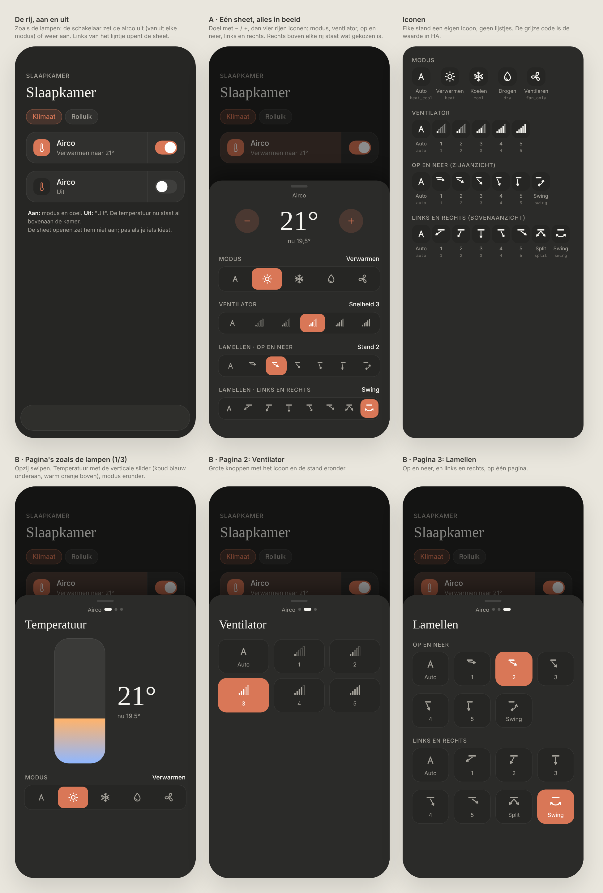
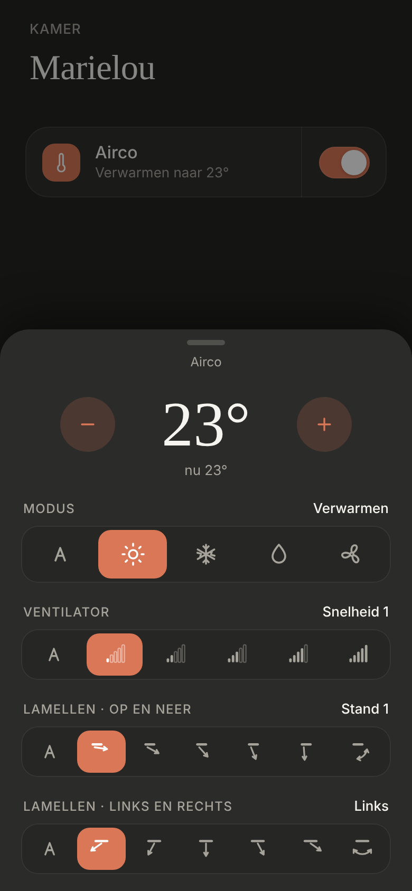
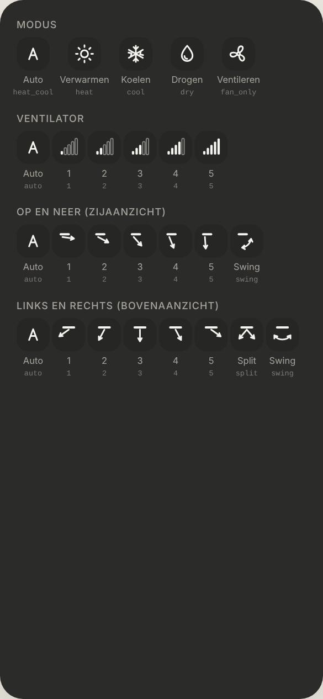

# Airco: row and sheet

The airco gets the light approach: a row with a switch, and a sheet with everything else. Dark mode only. Replaces the airco part of [room-tabs-airco](../room-tabs-airco/README.md) (option A there was never built).

> ✅ **Approved (option A) and built.** Don't change proportions or behaviour without asking first.
>
> Code: `AircoSheet` in `src/components/AircoSheet.tsx`, the HA calls in `src/lib/airco.ts`, the row in `RoomView.tsx`.

Source: [`mockup.html`](./mockup.html). As built (dev mode, a mock with the attributes of the airco in Marielou's room):

All icons. *Decision during the build:* the real unit has no Split for left and right, so that icon was dropped; the values HA uses are listed above.

## The row

- **Like a light with a sheet:** icon, "Airco", the second line, a thin divider, then the switch.
- **The switch** turns the airco off from any mode, or back on in its last mode (`climate.turn_off` / `climate.turn_on`).
- **Left of the divider** opens the sheet. Opening it doesn't turn the airco on.
- **Second line:** the mode and the target temperature ("Verwarmen naar 21°"), or "Uit". The current temperature isn't repeated, because the room header already shows it.

## The sheet (option A: everything on one sheet)

- **"Airco" next to the handle.** Swipe down or tap beside the sheet to close it (the shared `BottomSheet`).
- **Target temperature:** large, with − and + in the airco's own step (`target_temp_step`, usually 0.5°), within `min_temp` and `max_temp`. It's sent once you stop tapping. "nu 19,5°" is shown below it.
- **Four rows of icons.** Each row has its name on the left and the current choice on the right ("Verwarmen", "Snelheid 3", "Stand 2", "Swing"). The active icon is filled with the accent colour.
  - **Modus:** Auto, Verwarmen, Koelen, Drogen, Ventileren (`hvac_modes`, `climate.set_hvac_mode`).
  - **Ventilator:** Auto, then `speed_1`–`speed_5` as signal bars (`fan_modes`, `climate.set_fan_mode`).
  - **Lamellen · op en neer:** Auto, `position_1` (straight out) to `position_5` (straight down), Swing; seen from the side (`swing_modes`, `climate.set_swing_mode`).
  - **Lamellen · links en rechts:** Auto, `left`, `left_centre`, `centre`, `right_centre`, `right` (named Links … Rechts), Swing; seen from above (`swing_horizontal_modes`, `climate.set_swing_horizontal_mode`).
- **The design's order**, whatever order HA lists them in: Auto first, Swing last.
- **Only what the unit offers:** a mode or position HA doesn't list is left out, and a row with nothing left is hidden.
- **Choosing something while the airco is off** turns it on.

## Not chosen

- **B · three pages like the light sheet:** Temperatuur with a vertical slider, Ventilator, Lamellen. Everything on one sheet is quicker.
