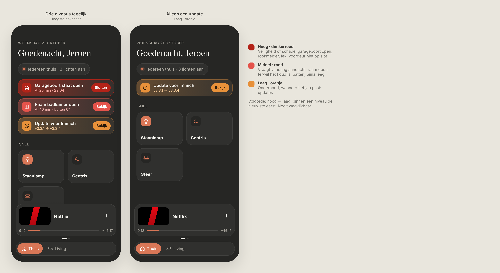

# Attention banner: warnings on Thuis

Warnings that need you to act, shown on **Thuis** directly under the status line. Dark mode only.

> ✅ **Approved and built** (depth option A: even colour, lit from above). The owner chose this design. Don't change colours, proportions or behaviour without asking first.
>
> Code: `src/config/attention.ts` (rules), `src/lib/attention.ts` (which warnings are active), `src/components/Attention.tsx`, styles under `attention` in `src/styles.css`.



Source: [`mockup.html`](./mockup.html) (a static mockup; open it in a browser, not part of the build). The mockup still shows the original left-to-right gradient and the buttons; the background was changed afterwards, see [Background](#background-depth-a) and [`depth.png`](./depth.png).

## Rules

- **Never closable.** There is no × anywhere. A warning disappears only when its cause is gone: the update is installed, the garage door is closed, the window is shut.
- **Always all of them, in a list.** Every active warning gets its own banner, stacked under the status line with 8px between them. There's no "+2 more" row and no sheet. With many warnings, "Snel" simply moves down.
- **Order:** highest level first; within a level, the newest first.
- **No buttons.** *Decision during the build:* the owner removed the action button from the mockup ("Sluiten", "Bekijk"). A banner only tells you something needs attention, and it isn't tappable.
- With no warnings, nothing is shown: no empty space, no "all good" card.

## Banner

One row (padding 12px 14px, radius 20px, 12px gap):

| Part | Spec |
|---|---|
| Icon tile | 34px, radius 11px, 18px icon. Raised: a vertical gradient of the level colour (lighter top, darker bottom), a 1px white highlight on top and a small drop shadow |
| Title | 15px / 600, `--text`, one line with ellipsis |
| Second line | 13px, a light tint of the level colour, one line with ellipsis (e.g. "Al 25 min · 22:04", "v3.3.1 → v3.3.4") |
| Action button | Removed during the build (see Rules) |

### Background (depth A)

The level colour covers the **whole card evenly**, so the right side never turns dark. Depth comes from light: slightly lighter at the top, darker at the bottom, a thin highlight along the top edge and a soft shadow under the card.

```css
background:
  linear-gradient(180deg, rgba(255,255,255,.08), rgba(0,0,0,.14)),
  color-mix(in srgb, var(--c) var(--tint), var(--surface));
box-shadow:
  inset 0 1px 0 rgba(255,255,255,.14),
  inset 0 0 0 1px color-mix(in srgb, var(--c) var(--edge), transparent),
  0 6px 16px -6px rgba(0,0,0,.6);
```

*Decision during the build:* this replaces the original left-to-right gradient, because its right side faded to almost black. The alternatives are in [`depth.png`](./depth.png) ([`depth.html`](./depth.html)).

## Severity levels

| Level | `--c` | Second line | `--tint` | `--edge` | Text on icon tile | For example |
|---|---|---|---|---|---|---|
| **Hoog** (`high`) | `#b42318` dark red | `#f2a49c` | 42% | 60% | white | Safety or damage: garage door open, smoke alarm, leak, front door unlocked |
| **Middel** (`medium`) | `#e5534b` red | `#f0b3ae` | 26% | 32% | white | Needs attention today: window open while it's cold, battery almost empty |
| **Laag** (`low`) | `#e8913a` orange | `#f3c99a` | 20% | 28% | dark `#2b1a0a` (white is unreadable on orange) | Maintenance, whenever it suits you: updates |

The orange is deliberately yellower than the dashboard's accent (`#d97757`), so a low warning never looks like a normal shortcut.

## Home Assistant mapping

Warnings are defined in `src/config/attention.ts`, like the rooms and shortcuts. For example:

```ts
{ entity: 'update.immich', level: 'low' },
{ level: 'high', entity: 'cover.garagepoort', title: 'Garagepoort staat open', icon: 'garage' },
```

- **Icons only:** the tile always shows an icon (from the rule, or one that fits the entity). *Decision during the build:* using the entity's own picture (e.g. the Immich logo) was tried and dropped; HA serves those logos from `/api/brands/…`, which refuses a plain `` without a login (403).
- **Updates:** an `update` entity with state `on`. The second line is `installed_version → latest_version`.
- **Shown immediately:** a warning appears as soon as the state matches. The second line shows how long it has lasted (from `last_changed`), plus the time it started. *Decision during the build:* an `after` delay (only show after N minutes) was built and dropped as too complex.
- **`when`:** the states that trigger it. Default: `open`/`opening` for a cover, `unlocked`/`open` for a lock, otherwise `on`.
- **`when` as a function** (*decision during the build*): instead of a list of states, a function `(entity) => boolean`, e.g. `(e) => Number(e.state) <= 20` for a low battery. Chosen over specific options like `below`, so new conditions need no new properties.
- **`detail` as a function** (*decision during the build*): an optional `(entity) => string` for the second line, e.g. a battery's percentage ("15%") instead of "Sinds 14:02".
- **Exact entity IDs only**, one rule per entity. *Decision during the build:* `*` wildcards (e.g. `update.*`) were built and dropped; the owner wants every warning listed explicitly.

## Not chosen

**Depth** ([`depth.png`](./depth.png)): B · diagonal (deep at the icon, lighter top right), C · spotlight on the right, D · two light sources with a coloured shadow, and E · full colour with white text (again made "Middel" look more urgent than "Hoog"). An earlier round of depth ideas (glow behind the icon, glass, sunken, stacked) all kept the dark right side.

**Gradient** [`gradients.png`](./gradients.png) ([`gradients.html`](./gradients.html)) shows the gradient experiments:

- **B · Glow from the corner:** too subtle; the three levels look too much alike.
- **C · Full colour:** the most alarming, but "Middel" looked more urgent than the dark red "Hoog", and white text on orange was unreadable.
- **D · Gradient border:** refined, but the urgency only came through the icon and button.

Earlier rounds that were also dropped: a neutral info style with a close button, a single colour for every warning, and the "+2 andere meldingen" row with a sheet.
