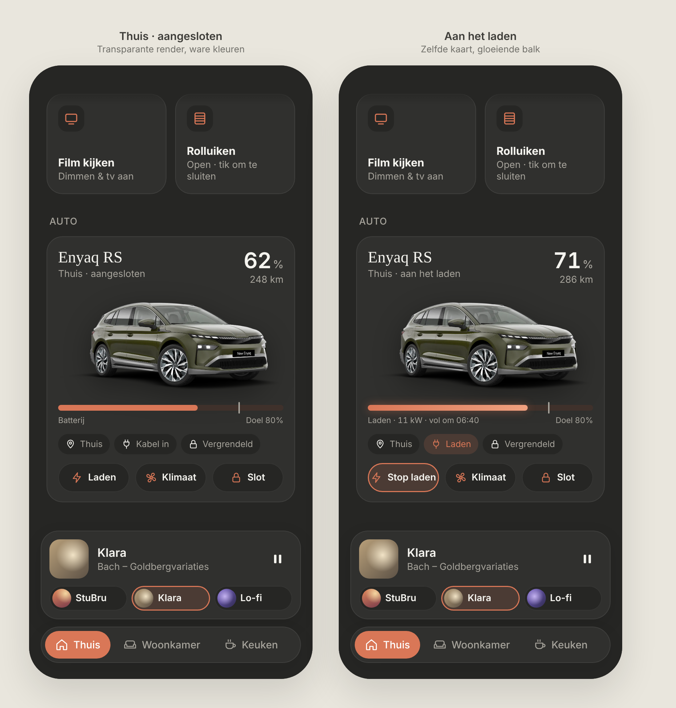

# Auto: Škoda Enyaq RS

A card for the owner's upcoming **Škoda Enyaq RS in Smokey Grey**. Dark mode only, in the same design system as the [media card](../media-card/README.md), [cameras](../cameras/README.md) and [nutsvoorzieningen](../nutsvoorzieningen/README.md).

> 💾 **Saved concept for later.** The owner likes the direction, but it's not formally approved yet and there are open questions (below). Revisit once the car arrives.

Source: [`auto.html`](./auto.html) (a static mockup, not part of the build). It references `enyaq-render.png`, which is **not in the repo**. The screenshot above was made with a test render the owner provided, of a different color and trim. Without the file, the HTML shows an empty image area.

---

## Card, top to bottom

1. **Header:** "Enyaq RS" (serif, 22px) with a location/status line below it ("Thuis · aangesloten", "Thuis · aan het laden", "Onderweg · Gent"). On the right: **battery %** (30px/600) and **range in km**.
2. **Car image:** the official render, about 150px high, `object-fit: contain`, with a soft drop shadow.
   - It must be a render with a **transparent background**, placed directly on the card, so the colors stay true.
   - ❌ Don't use `mix-blend-mode: multiply` to hide a white background: it makes the car far too dark.
   - If a render has a white background, cut it out once and store it as a transparent PNG.
   - If no image is available, leave the image area out entirely. Never show a drawn placeholder (a hand-drawn SVG car was tried and rejected).
3. **Battery bar:** an 8px pill in the accent color, with a thin marker at the **charge target** ("Doel 80%"). While charging, the bar has a lighter gradient with a soft glow, and the label reads "Laden · 11 kW · vol om 06:40".
4. **Status chips:** location, cable/charging and lock. An active state is shown in accent (e.g. "Laden", "Klimaat 20°").
5. **Actions:** pill buttons, for example **Laden / Stop laden**, **Klimaat / Klimaat uit**, **Slot**. The active state is outlined in accent. When the car is away from home, the charge button disappears.

## Image source (when the car arrives)

The **MySkoda** integration in HA exposes official renders of the actual car (color, wheels, trim) as image entities. Use that; usually it's a PNG with transparency.

## Open questions

- **Placement on Thuis:** between Snel and Camera's, or elsewhere?
- **Actions:** through the owner's own HA scripts (like cameras and streams), or directly on the MySkoda entities?
- **Charge target:** 80%, or another value?
- **Entity IDs:** to be provided once the car is in HA.
