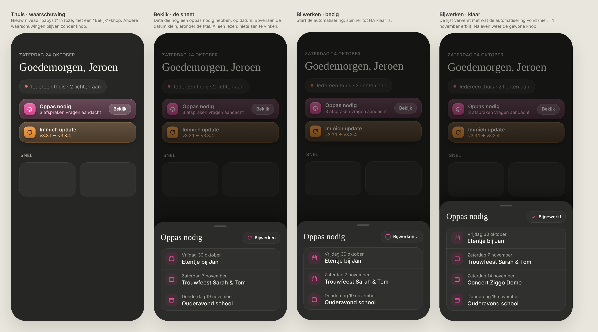
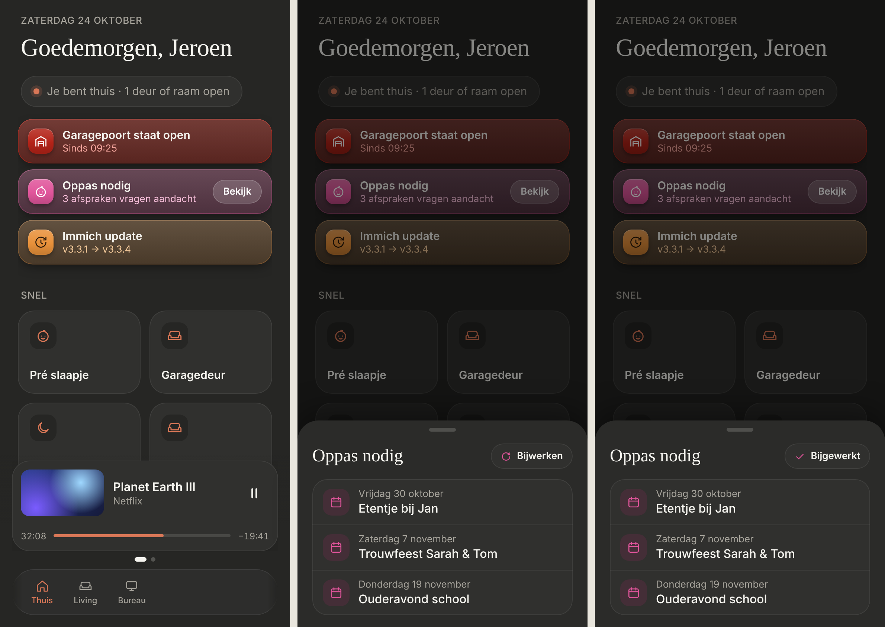

# Babysit: "Oppas nodig"

A warning on Thuis when appointments still need a babysitter, with a sheet that lists them. Dark mode only. Builds on the [warnings](../attention-banner/README.md).

> ✅ **Approved and built.** Don't change proportions or behaviour without asking first.
>
> Code: the rule in `src/config/attention.ts`, `BabysitSheet` in `src/components/sheets/`, the parsing in `src/lib/babysit.ts`, the automation in `src/config/babysit.ts`.

Source: [`mockup.html`](./mockup.html). As built (dev mode, mock data):

## Where the data comes from

Your HA automation scans the calendars every night and adds an item to the todo list `todo.babysitter_needed` for every "(BABYSIT)" appointment that has no babysitter yet, e.g. "30/10: (BABYSIT) Etentje bij Jan". The dashboard only reads that list: nothing can be ticked off from the dashboard.

## The warning

- **A new level, `babysit`, in pink** (`#e0559b`), with the baby icon. It sorts between the red levels and orange (`low`).
- **"Oppas nodig"**, and as the second line the number from HA's state: "3 afspraken vragen aandacht" ("1 afspraak vraagt aandacht" for one). HA's state is the number of open items, past dates included.
- **"Bekijk"** opens the sheet. Only warnings with a `sheet` in the config get this button; the others only warn.

## The sheet

- **Title "Oppas nodig"**, with **"Bijwerken"** on the right.
- **Every open item of the list**, past dates included, so the count matches the warning. Earliest date first; an item without a date goes last.
- **Two lines per item:** the date small on top ("Vrijdag 30 oktober"), the title below ("Etentje bij Jan"), without "(BABYSIT)". The list has no year, so the year is the one that puts the date closest to today ("05/01" in December is next January).
- **The list updates by itself** while the sheet is open (HA's `todo/item/subscribe`).
- **"Bijwerken"** triggers the automation (`automation.trigger`). While it runs: a spinner with "Bijwerken…", then "✓ Bijgewerkt" (or "Dat lukte niet"), then back to "Bijwerken". New items appear as soon as HA reports them. The automation also sends its own notification when it finds new dates.

## Sheets on warnings (for later)

A warning rule can name any component as its `sheet`; it gets `hass`, the warning's `entity` and `close`. The frame (dimmed page, handle, swipe down to close) is the shared `BottomSheet`, also used by Veiligheid and the light sheet. A later example: an Immich changelog sheet on the update warning.

## Not chosen

- Showing the first date in the warning ("vanaf vr 30 okt"): that needs the items, not just HA's count.
- Hiding past dates: the count in the warning would then differ from the list.
- A "Nieuw" label for just-found dates, and a subtitle under the title.
