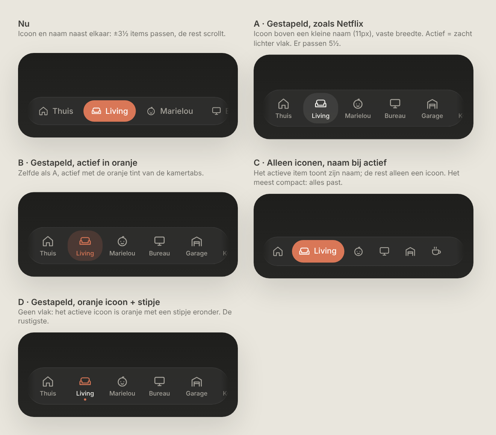
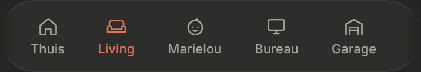

# Bottom navigation: compact

The bar at the bottom with Thuis and the rooms, made more compact so more rooms fit. Dark mode only. Inspired by the Netflix iOS tab bar.

> ✅ **Approved (option B) and built.** Don't change proportions or behaviour without asking first.
>
> Code: `BottomNav.tsx` (unchanged markup) and the `bottom-nav` styles in `src/styles.css`.

Source: [`options.html`](./options.html). The chosen option is **B** (left, second row).

As built (dev mode, with two extra example rooms to show the overflow):

## Design (B)

- **Stacked items:** the icon (18px) above a small name (11px, medium weight), centred. Each item is **as wide as its name** plus 12px on both sides (at least 52px), so about 5 items fit on a 390px-wide phone (the old bar fits about 3½). *Changed during the build:* a fixed width of 62px cut long names off ("Slaapka…") and left the active highlight almost no padding.
- **Active item:** only the icon and name turn orange (`--accent`), with no area behind them. *Changed during the build:* first the soft orange area of the room tabs (`--accent-soft`) behind them, and the icon went from 22px to 18px.
- **The bar** keeps its look: the glassy pill with blur, now with a slightly smaller corner radius (30px) for the taller items.
- **Inside padding of 14px** left and right, as wide as the edge fades, so the first and last item are never dimmed. Names are never cut off.
- **Overflow stays as it is:** with more rooms than fit, the bar scrolls sideways, with soft fades on the edges, and the active item is scrolled into view.
- Tap gives the same selection haptic as now.

## Not chosen

- **A · Stacked, active as a lighter area** (closest to the Netflix example): the only place where "active" wouldn't be orange.
- **C · Icons only, the name only on the active item:** fits the most, but rooms would have to be recognised by their icon alone, and some icons look alike (Thuis and Garage are both houses).
- **D · Orange icon with a dot, no area:** the quietest, but the active item stands out less.
