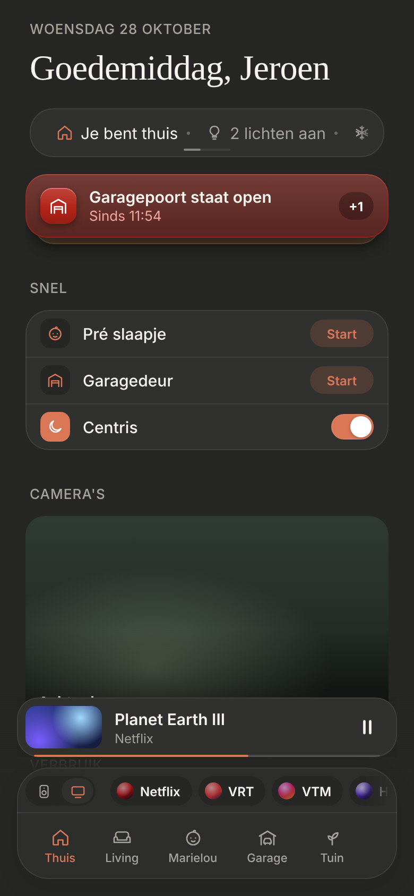
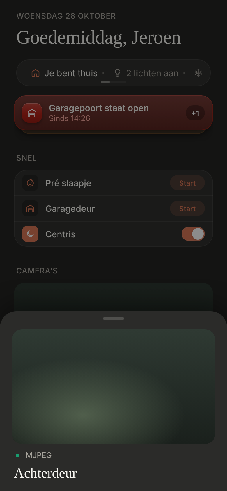

# Cameras

Cameras on **Thuis**, with a live sheet. Dark mode only. Builds on the [media card](../media-card/README.md) and uses the same handle, dots and snapping swipe patterns; the sheet is the shared `BottomSheet`.

| Part | Status |
|---|---|
| Tiles on Thuis, live sheet | ✅ **Approved and built**, brought back to the bare minimum (see [Removed](#removed)). |
| Streaming | ✅ **Built:** WebRTC (3 attempts) → HLS → MJPEG → still image. See [Streaming](#streaming). |
| Code | ✅ Refactored for readability, as in [`code-structure.md`](./code-structure.md). |

> ✅ **The design is final.** Don't change layout, proportions or content without asking first.

The original mockup, from before the parts in [Removed](#removed) were taken out: [`cameras.png`](./cameras.png), source [`cameras.html`](./cameras.html).

As built (dev mode, mock data), Thuis and the live sheet:





---

## Config

`src/config/cameras.ts`, in display order: the first camera gets the large tile. Cameras missing in HA are left out; with none left, there is no section.

```ts
{ entity: Entity.BACK_DOOR_CAMERA, name: 'Achterdeur' },
```

**For now only the Achterdeur** (`camera.back_door_fluent_lens_0`). The Garage and the Zijpad follow once their entities are known.

## On Thuis

- A **"Camera's"** section below **Snel**, above Verbruik.
- **Fixed layout:** the first camera as one large tile, 16:9, full width; the others as small tiles, 4:3, two side by side. The gap is 10px and the radius 18px. The order never changes.
- Each tile shows a still image, **refreshed every 10 s** while Thuis is visible (not behind the open sheet), with the **camera name** at the bottom left (white, 14px/600, on a soft bottom gradient). No time and no motion indicators.
- Tapping a tile opens the live sheet on that camera.

## Live sheet

- The shared **`BottomSheet`**: the dimmed page, the grab handle, swipe the handle down or tap the dimmed page to close. **Page dots** under the handle only with more than one camera.
- **Swipe left/right** between cameras with the same snapping as the media card.
- Each page, top to bottom:
  1. **Live image** (16:9, radius 18), with the still image underneath until the video plays, so it's never black.
  2. **One status line** (see below).
  3. **Name** (serif, 24px).
- Only the camera in view streams. Swiping away or closing stops it.

### The status line

| | Shows |
|---|---|
| Connecting | spinner · "Verbinden…" |
| Playing | green dot · "WebRTC · lokaal", "WebRTC · direct" or "WebRTC · relay" (the route), "HLS" or "MJPEG" |
| Nothing worked | grey dot · "Stilstaand beeld" |

## Streaming

The same route as HA's own player. Everything goes through Home Assistant: the video comes from HA's go2rtc, the agreement goes over HA's websocket, and away from home the video goes through Nabu Casa's relay.

1. **Ask HA** what the camera supports (`camera/capabilities`).
2. **WebRTC**, up to **3 attempts**, each at most **5 s**, with **1 s** between attempts. Only when HA offers it and there's a websocket.
3. **HLS**, at most **15 s** (HA first has to build the stream). Only where the browser plays it itself (iOS, Safari).
4. **MJPEG** (`/api/camera_proxy_stream`), at most **8 s**. It counts as playing once the image has its first frame (its size), because MJPEG's `load` event doesn't always come.
5. **Still image** if none of these worked.

A step fails when it reports an error, or when its time runs out without a picture; then the next step starts. **A stream that drops after it played** (the WebRTC connection lost, or the video or image failing) starts again from WebRTC attempt 1.

Video plays muted (iOS requires that for autoplay); there's no sound button.

## Removed

On the owner's decision (28 October), to get back to the bare minimum:

- **Frigate:** the "Vandaag" list of today's events, with thumbnails and labels.
- **"Vandaag" and the "Geen opnames" placeholder.**
- **The actions:** buttons that run an HA script or automation per camera. To come back once the scripts are known.
- **The "● LIVE" pill** next to the name: the status line says the same.
- **Dimming the image** while connecting.
- **The detailed status line** (option C3): the attempt counter, the countdown bar, the device name and the time to the first frame. Its mockups: [`stream-status.png`](./stream-status.png), [`stream-status-options.png`](./stream-status-options.png).
- **The sheet's own handle and dragging**, replaced by the shared `BottomSheet`.

## Open

- The Garage's and the Zijpad's entity IDs.
- **WebRTC through the relay at home:** if the status line shows "WebRTC · relay" on the home Wi-Fi, go2rtc probably doesn't offer an address the phone can reach. The usual fix is go2rtc's `webrtc: candidates` with the server's IP and port 8555.
