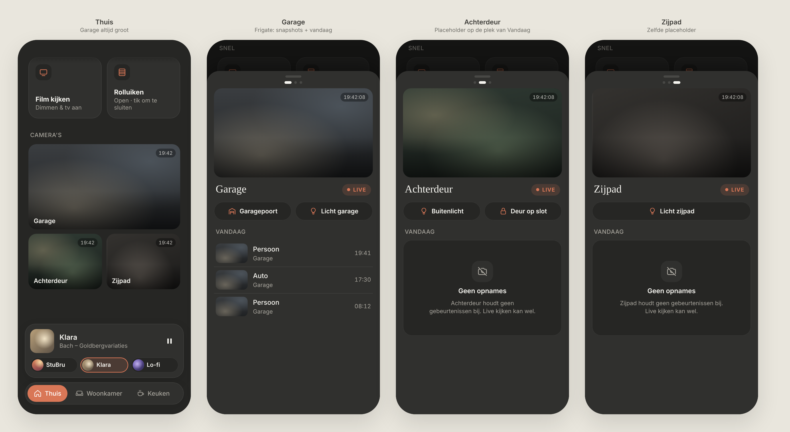
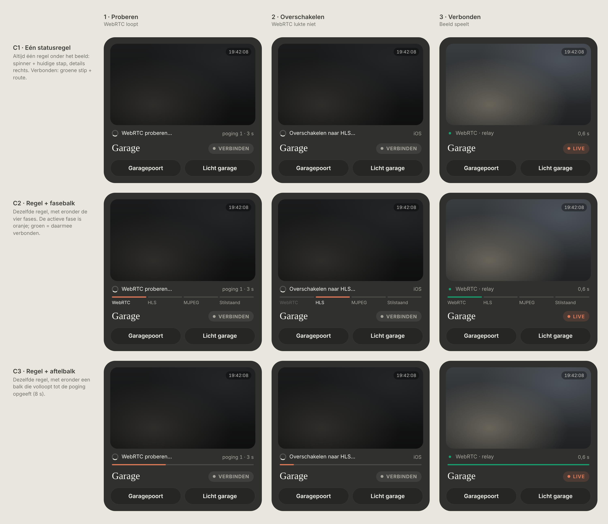
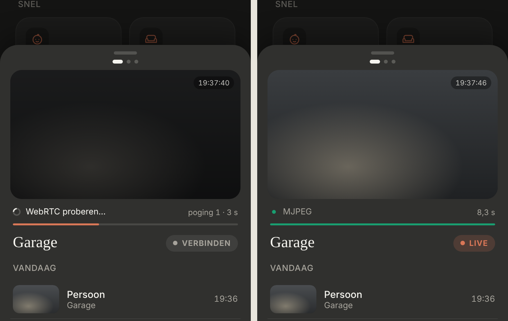

# Cameras

Three cameras on **Thuis**: Garage, Achterdeur and Zijpad. Dark mode only. Builds on the [media card](../media-card/README.md) and uses the same sheet, handle, dots and snapping swipe patterns.

| Part | Status |
|---|---|
| Layout, tiles, live sheet, actions, events, placeholder | ✅ **Approved: final. Built** (branch `claude/cameras`), not yet tested against the real cameras. |
| Streaming technique (how live video is delivered) | ✅ **Decided and built:** HA's order, WebRTC → HLS → MJPEG → still, with a visible stream status (option C3). See [Streaming](#streaming). |

> ✅ **The design is final.** The owner approved it. Don't change layout, proportions or content without asking first.



Source: [`cameras.html`](./cameras.html) (a static mockup; open it in a browser, not part of the build).

---

## As built

As built (dev mode, mock data). Thuis, then the sheet on Garage, Achterdeur and Zijpad:


### Config

`src/config/cameras.ts`, in display order (the first camera is the large tile). Cameras missing in HA are left out; with none left, there is no section.

```ts
{
  entity: 'camera.garage',
  name: 'Garage',
  frigate: 'garage',
  actions: [{ label: 'Garagepoort', icon: 'garage', script: 'script.garagepoort' }],
},
```

- `entity`: the HA camera entity. **The IDs in the config are placeholders** (`camera.garage`, `camera.achterdeur`, `camera.zijpad`) until the real ones are known.
- `frigate`: the camera's name in Frigate. With it, "Vandaag" shows Frigate's events; without it, the placeholder.
- `actions`: empty for now. A `script.` is started, an `automation.` is triggered.

### Streaming

The same order as HA's own player, so it behaves like HA's cards. Everything goes through Home Assistant: the video comes from HA's go2rtc (or Frigate's, if HA is pointed at it), and the agreement goes over HA's websocket.

1. **Ask HA** what the camera supports (`camera/capabilities`).
2. **WebRTC** (fast, ~0.5 s): at home straight over WiFi, away from home via Nabu Casa's TURN relay (HA hands it out through `camera/webrtc/get_client_config`). Up to **8 s**, with a new attempt if one fails early.
3. **HLS** (1–5 s delay), only where the browser plays it itself (iOS, Safari): up to **15 s**, because HA first has to build the stream.
4. **MJPEG** (`/api/camera_proxy_stream`) in every other browser: up to **8 s**.
5. **Still image** if none of these work.

Only the camera in view streams; swiping or closing stops it. Video starts muted (iOS requires that for autoplay); there's no sound button. Tiles on Thuis stay still images, refreshed every 10 s while Thuis is visible.

### Stream status: option C3 ✅

One fixed line under the live image shows only the **active** phase; nothing is kept. Below it, a bar fills up until that phase gives up. The layout never moves.



Source: [`stream-status.html`](./stream-status.html). Approved: **C3** (bottom row). Not chosen: C1 (line only), C2 (phase bar), and the earlier A/B/C ([`stream-status-options.png`](./stream-status-options.png)): a log in the image, a centred status, a persisted step list.

| Phase | Line | Right | Bar |
|---|---|---|---|
| WebRTC | spinner · "WebRTC proberen…" | "poging 1 · 3 s" | orange, fills over 8 s |
| HLS / MJPEG | spinner · "Overschakelen naar HLS…" | "iOS · 2 s" (detected device) | orange, restarts and fills over that phase's time |
| Connected | green dot · "WebRTC · relay" (route: lokaal / direct / relay), or "HLS" / "MJPEG" | time to first frame, "0,6 s" | full, green |
| Nothing worked | grey dot · "Stilstaand beeld" | "geen stream" | empty |

- While connecting, the image is dimmed and the pill reads **"Verbinden"** (grey). It turns into **"LIVE"** once the first frame plays; **"Stilstaand"** if it ends on the still image.

As built (dev mode, mock data: WebRTC never answers, then MJPEG):



### Frigate events

Via the Frigate integration's websocket command `frigate/events/get` (instance `frigate`, today since midnight, newest first, max 50). Thumbnails come from `/api/frigate/frigate/thumbnail/<id>`, signed with `auth/sign_path` so an `` can load them. Labels in Dutch: Persoon, Auto, Fiets, Motor, Hond, Kat, Vogel, Pakje; anything else as Frigate names it.

- **Quiet day** (Frigate, but nothing yet today): the placeholder with *"Nog niets gebeurd vandaag."* (the suggestion below).
- **Frigate not reachable:** the placeholder with *"Frigate is niet bereikbaar."*

---

## On Thuis

- A **"Camera's"** section below **Snel**. The page scrolls behind the docked mini media player, which stays visible.
- **Fixed layout:**
  - **Garage:** one large tile, 16:9, full width.
  - **Achterdeur and Zijpad:** two small tiles below it, 4:3, side by side. The gap is 10px and the radius 18px.
- The order is **fixed** and never changes based on motion.
- Each tile shows a still image with the **camera name** at the bottom left (white, 14px/600, on a soft bottom gradient). *Decision during the build:* the time of the image at the top right was removed at the owner's request.
- **No motion indicators on the tiles:** no labels, no accent border, no "last motion" text.
- Tapping a tile opens the live sheet on that camera.

## Live sheet

- A bottom sheet over the dimmed page, top radius 28px, with a **grab handle** and **3 page dots** under it. Their order is Garage, Achterdeur, Zijpad.
- **Swipe left/right** between cameras with the same snapping as the media card: always a whole camera, never halfway, one per swipe. Close it by swiping down on the handle or tapping the dimmed page.
- Every sheet has the same structure, top to bottom:
  1. **Live image** (16:9, radius 18). *Decision during the build:* the running clock at the top right was removed at the owner's request.
  2. **Name** (serif, 24px) with a **"● LIVE"** pill on the right.
  3. **Actions:** 1–2 pill buttons, 42px high, sharing the width equally.
  4. **"Vandaag":** the event list, or the placeholder.
- The sheet height is the same for every camera, so swiping doesn't jump.
- Only the visible camera streams. The stream stops on swipe and when the sheet closes.

### Actions

- Every action **only triggers a Home Assistant script or automation** (fire and forget, like the stream buttons in the media card). All the logic lives in HA.
- Feedback while it runs: a spinner, then ✓, or "Dat lukte niet" on failure.
- Configured per camera, with any number of buttons (1–2 fit best):

  ```ts
  { label: 'Garagepoort', icon: 'garage', script: 'script.garagepoort' }
  ```

- Examples in the mockup:

  | Camera | Actions |
  |---|---|
  | Garage | Garagepoort, Licht garage |
  | Achterdeur | Buitenlicht, Deur op slot |
  | Zijpad | Licht zijpad |

  The final list of scripts is still to be provided.

### "Vandaag"

- **Garage** (in Frigate): today's Frigate events, one per row: a snapshot thumbnail (72×44, radius 10), the label (Persoon / Auto / …), the camera name, and the time on the right.
- **Achterdeur and Zijpad** (not in Frigate): a **placeholder card** in the same spot. It has a crossed-out camera icon, **"Geen opnames"**, and *"{camera} houdt geen gebeurtenissen bij. Live kijken kan wel."*
- When a camera is added to Frigate later, it automatically gets the event list instead of the placeholder.

---

## Streaming: the earlier discussion

Decided: see [Streaming](#streaming) above (HA's own route, with Nabu Casa's relay away from home). The options discussed before:

| Option | Pros | Cons |
|---|---|---|
| HA's `ha-camera-stream` element | WebRTC/HLS chosen automatically | ❌ Rejected: only exists inside the HA frontend, and the dashboard must also work outside HA |
| Native `<video>` + HLS from HA (`camera/stream` via `callWS`) | The device's own player; works wherever `hass` exists, including remotely through HA auth | 1–5 s delay; desktop Chrome needs `hls.js` (dev only) |
| Native `<video>` + go2rtc directly (HLS/MP4/MSE, `frame.jpeg` for tiles) | Fast, low latency, native player | Usually LAN-only with no auth; mixed-content issues with an HTTPS HA; can't be reached away from home |
| Per camera: go2rtc at home, HA as the fallback | The best of both | More configuration |

Questions for that discussion:
- Which go2rtc is in use (Frigate's, an add-on, or HA's built-in)? Are all three cameras in it?
- Is the dashboard used away from home (mobile data), or only on the home network?
- Tiles on Thuis: still images refreshed about every 10 s while Thuis is visible (from `entity_picture` or go2rtc `frame.jpeg`).

## Other open questions

- Final action scripts per camera.
- Garage on a quiet day (Frigate, but no events yet today): reuse the placeholder with *"Nog niets gebeurd vandaag"*?
- Camera entity IDs. *For now only Achterdeur is configured* (`camera.back_door_fluent_lens_0`, `Entity.BACK_DOOR_CAMERA`); as the only camera it gets the large tile. Garage and Zijpad follow once their entities are known.
