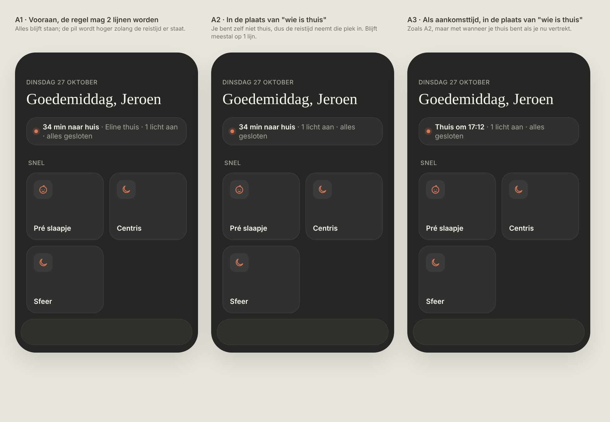
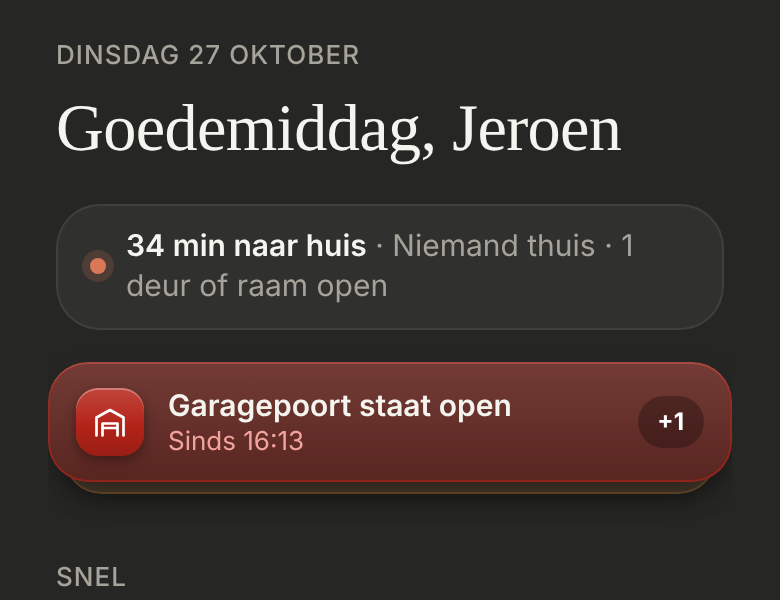

# Commute: "34 min naar huis"

> **Changed by the [now ticker](../now-ticker/README.md):** "34 min naar huis" is now an item in the scrolling status band, not bold and not a link. The route in Waze moved to "Naar huis" in the "Nu" sheet, with a "Start route" button.

On office days, the travel time home sits at the front of the status line on Thuis. Dark mode only. Quiet on purpose: it's not a warning.

> ✅ **Approved and built (option A1).** Don't change proportions or behaviour without asking first.
>
> Code: `commute()` in `src/lib/houseStatus.ts` (the conditions and the Waze link), shown by `Header` in `src/components/Header.tsx`.

Source: [`mockup.html`](./mockup.html). As built (dev mode, mock data, Tuesday 16:38):

## When it shows

All of these at once, the same as the old HA card:

- **Jeroen is logged in** (HA user `948e49d9b8eb426aa1f994c353e0aad9`).
- **Tuesday or Wednesday, from 16:00 until 18:00** (18:00 itself no longer counts).
- **`person.jeroen` is in the Banqup zone.**
- **`sensor.commuting_home_travel_time_jeroen` has a number.** HA updates it every 5 minutes.

The conditions are written in `commute()`, with no separate config file.

## How it looks

- **In front of the status line**, in bold: "**34 min naar huis** · Niemand thuis · 1 deur of raam open". The minutes are rounded.
- **The rest of the line stays.** While the travel time is shown, the line may wrap onto two lines.
- **Tapping "34 min naar huis"** opens Waze with the route to the "Home" favourite saved in Waze (`https://waze.com/ul?favorite=home&navigate=yes`). The rest of the line does nothing.

## Not chosen

From the first round ([`options.png`](./options.png)):

- **B:** next to the date.
- **C:** a second, smaller pill with "thuis om 17:12".
- **D:** a card in Snel.
- **E:** a bar above the navigation.

From the second round:

- **A2:** the travel time in place of "who is home".
- **A3:** "Thuis om 17:12" in place of "who is home".
