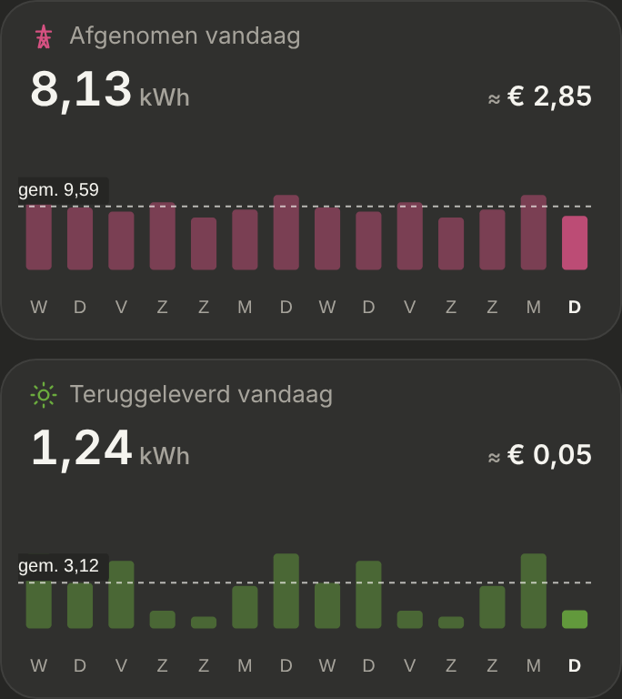

# Day tile

A reusable tile for **a total for today (so far)**: the name with its icon, the value, and optionally a bar against an ordinary day and the amount in euros. Dark mode only.

> ✅ **Approved (C1) and built** (4 November), then **D2** the same day: full width, with the days before today as bars. The shared component for every tile that shows a total for today: see the design rule in `CLAUDE.md`. Don't change proportions or behaviour without asking first.
>
> Code: `DayTile` in `src/components/DayTile.tsx`, `fetchDailyTotalsWithDays` in `src/lib/statistics.ts`, styles under "Day tile" in `src/styles.css`. First used by [Vandaag tot nu](../energie-vandaag/README.md).

How it got here: the options for extra information (E1: yesterday, E2: per hour, E3: euros, E4: against an ordinary day): [`options.png`](./options.png) ([`options.html`](./options.html)); E3 and E4 combined, C1 (built first) and C3: [`mockup.png`](./mockup.png) ([`mockup.html`](./mockup.html)); full width with 14 days, D1 to D3: [`days-options.png`](./days-options.png) ([`days-options.html`](./days-options.html)); D2 with the day letters: [`days-mockup.png`](./days-mockup.png) ([`days-mockup.html`](./days-mockup.html)). As built (dev mode, mock values):



## Usage

```tsx
<DayTile
  name="Afgenomen vandaag"
  icon="pylon"
  color={ENERGY_NOW.fromGridColor}   // a 6-digit hex colour
  value={4.82}
  unit="kWh"
  decimals={2}
  previousDays={dailyTotals}         // optional: the bars and the dashed average
  euros={1.69}                       // optional: "≈ € 1,69"
/>
```

`previousDays` is a list of `{ dayStart, total }`, oldest first, from `fetchDailyTotalsWithDays(hass, entityIds, numberOfDays)`. In a `day-tiles` list the tiles are full width, one under the other, 10px apart.

## The tile (D2)

- **Name** (13px, muted) with its **icon** (16px) in `color`.
- **Value** (26px, 600) with `decimals` decimals and its unit on the left; **"≈ € 1,69"** (15px, 600; the "≈" muted) on the right, on the same line. The average isn't next to the price any more: it's on the chart.
- **With `previousDays`:** an ApexCharts bar chart (110px): a bar per day before today and **today's bar last**, today in the full `color`, the others at 45%. Under each bar the **first letter of its day** in Dutch ("D V Z Z M D W": D and Z each stand for two days, as the owner chose); today's letter is white and bold. The **average of the days before today** is a dashed line with the label "gem. 9,59". No y-axis, no grid, no tooltip.
- Without `previousDays` (or while they're being fetched) it's just the name, the value and the euros.

## In ApexCharts

A normal bar chart (`apexcharts/bar`), not a sparkline, so the x-axis can carry the day letters (`xaxis.categories`); axis border, ticks, y-axis and grid off. `plotOptions.bar.distributed` gives each bar its own colour (an 8-digit hex: the colour plus `73` for the earlier days). The dashed average is a y-axis annotation (`apexcharts/features/annotations`) with its own label. ApexCharts takes one font weight for all axis labels, so today's (the last) is bold through CSS.
