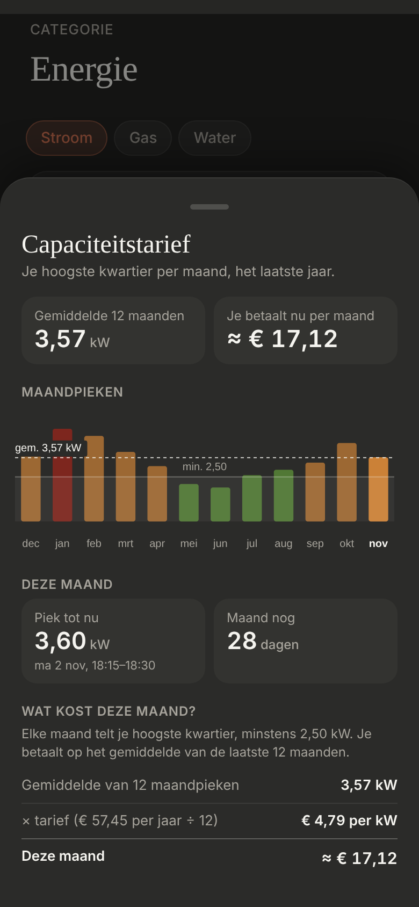

# Energie: Capaciteitstarief

A bottom sheet with the capaciteitstarief over the year, opened from "Dit kwartier" ([energie-kwartier](../energie-kwartier/README.md)) on Stroom. Dark mode only.

> ✅ **Sheet approved and built.** **How it opens isn't decided yet:** the owner didn't like L1–L3 in the options. For now a tap anywhere on the quarter-hour part opens it, with nothing on the card to show it. Don't change proportions or behaviour without asking first.
>
> Code: `CapacitySheet.tsx` and `QuarterPeak.tsx` in `src/components/energy/`, `ENERGY_QUARTER` in `src/config/energy.ts`, `fetchMonthlyMaximums` and `fetchWhenValueWasReachedThisMonth` in `src/lib/statistics.ts`, styles under "Capaciteitstarief" in `src/styles.css`.

The approved sheet: [`mockup.png`](./mockup.png) ([`mockup.html`](./mockup.html)). The first options for opening it (L1–L3, none chosen) and the first sheets (S1, S2): [`options.png`](./options.png) ([`options.html`](./options.html)). As built (dev mode, mock values):

## How the tariff works

Every quarter-hour the meter measures the average power. The highest quarter-hour of a month is the **monthly peak**, counted as at least **2,5 kW**. Each month the bill takes the **average of the last 12 monthly peaks** × the price per kW per year ÷ 12. It's part of the network costs, so it's in the advance to the supplier (Eneco), and the annual statement settles it per month.

**The price:** Fluvius Imewo (around Gent), 2026: **€57,45 per kW per year** (`ENERGY_QUARTER.euroPerKilowattPerYear`), from a secondary source (callmepower.be); not confirmed whether this includes 6% VAT. Fluvius can change it during the year.

## The sheet

All numbers with **two decimals** (the owner's choice), except the days.

- **Title** "Capaciteitstarief" (serif, 24px), "Je hoogste kwartier per maand, het laatste jaar."
- **Two figures:** "Gemiddelde 12 maanden" (kW) and "Je betaalt nu per maand" (≈ €).
- **Maandpieken:** an ApexCharts bar chart, a bar per month (this month last, its name bold), coloured by the quarter-hour bar's bands (green up to 3 kW, orange up to 5, then red), earlier months at 60%. The minimum as a line over a shaded band ("min. 2,50"), the average as a dashed line ("gem. 3,57 kW"). No legend.
- **Deze maand:** "Piek tot nu" (kW), with the quarter-hour it was reached in ("ma 2 nov, 18:15–18:30") when HA's history can tell; "Maand nog" (days, today included).
- **Wat kost deze maand?** One sentence ("Elke maand telt je hoogste kwartier, minstens 2,50 kW. Je betaalt op het gemiddelde van de laatste 12 maanden."), then the calculation: the average × the price per month (€57,45 ÷ 12) = this month's cost.
- Scrolls inside the sheet when it's higher than 85% of the screen.

## Where the numbers come from

- **The earlier months:** HA's monthly long-term statistics (`max`) of `sensor.p1_meter_peak_demand_current_month`, fetched again every 5 minutes. It needs a `state_class`, or HA keeps no statistics. A month without statistics is left out, and the average is over the months there are ("Gemiddelde 4 maanden").
- **This month:** the sensor's state.
- **When the peak was reached:** HA's history of the same sensor this month, the first moment of its current value. HA keeps history about 10 days, so for an older peak there's no time. Whether the meter updates the peak during the quarter-hour or at its end isn't checked: at its end, the shown quarter-hour would be one too late.
- **The chart:** ApexCharts keeps 30px free above the bars; `grid.padding.top: -22` takes most of it away.
