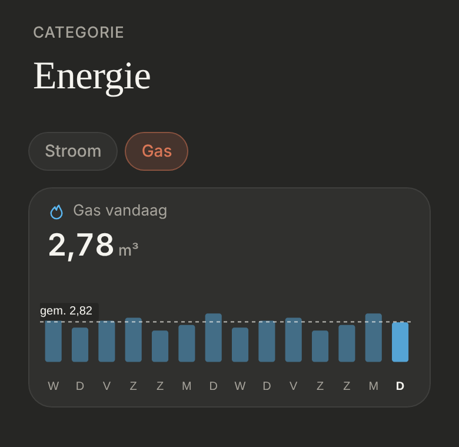
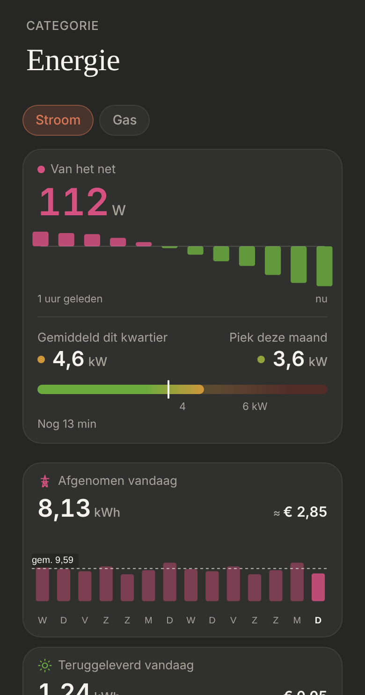

# Energie: Gas

Gas on the [Energie](../nav-categories/README.md) page, behind a **"Gas" chip** next to "Stroom", like a room's tabs. Dark mode only.

> ✅ **Approved and built** (4 November): the owner's own choice after the designs below: not a page of its own in the bar (too little data for that), but a chip on Energie with the last 14 days. Don't change proportions or behaviour without asking first.
>
> Code: `EnergyPage.tsx` (the chips) and `GasLastDays.tsx` in `src/components/energy/`, `ENERGY_GAS` in `src/config/energy.ts`, the shared `DayTile`.

The designs that led here: Gas as its own page in the bar (G1 to G3): [`page-options.png`](./page-options.png) ([`page-options.html`](./page-options.html)); a fuller Gas page: [`full-page.png`](./full-page.png) ([`full-page.html`](./full-page.html)); Gas like Stroom, with 5-minute bars: [`like-stroom.png`](./like-stroom.png) ([`like-stroom.html`](./like-stroom.html)). As built (dev mode, mock values):

## The chips

- **"Stroom", "Gas" and "Water"** ([energie-water](../energie-water/README.md)) under the title, the same chips as a room's tabs (`room-tabs`, `room-tab`): the active one in the accent tint.
- **"Stroom"** is the page as it was ([energie-page](../energie-page/README.md), S2). The page always opens on Stroom; nothing is remembered.

## Gas

- **One [day tile](../day-tile/README.md):** "Gas vandaag" in m³ (two decimals), with the 13 days before today and today as bars, a first letter per day (today's bold, its bar brighter) and their average as a dashed line.
- **Purple** `#a37cf0` (`ENERGY_GAS.color`), the owner's choice; it was light blue `#5cb8f2`. Thuis' gas tile has the same colour (`UTILITY_COLORS.gas`).
- **Source:** `sensor.gas_meter_consumption_daily` (today, from its state) and its daily statistics in HA (the days before), fetched again every 5 minutes.
- **"≈ €":** today's m³ times `ENERGY_GAS.euroPerCubicMetre`, for now an **estimate on the high side, €1,30 per m³** (all-in about €0,12 per kWh × about 10,8 kWh per m³) until the price on the bill replaces it.
