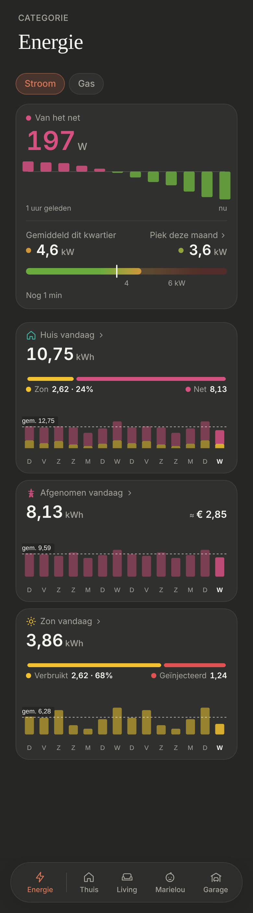
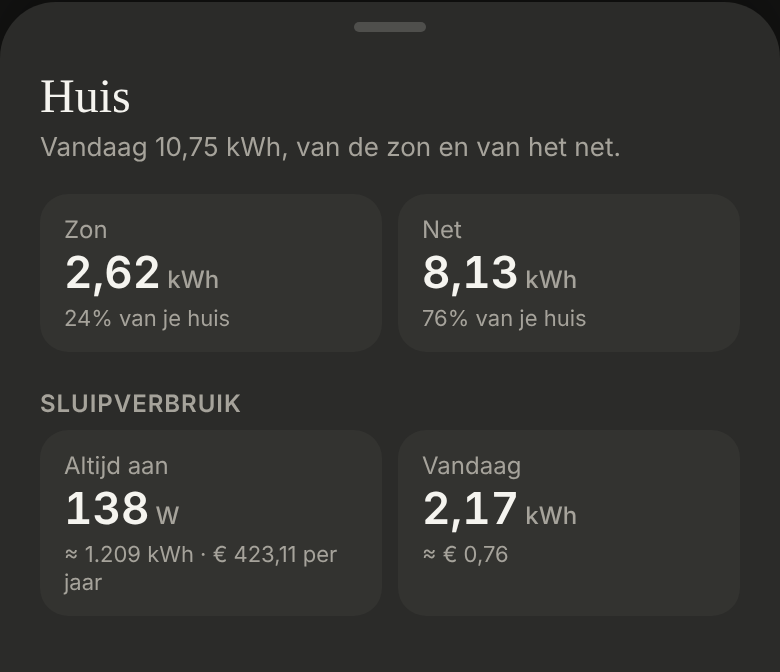

# Energie: Huis vandaag

What the house used today, at the top of the day tiles under **Stroom**: from the grid and from its own solar. Dark mode only.

> ✅ **Approved (H3, with the labels "Zon" and "Net") and built.** Don't change proportions or behaviour without asking first.
>
> Code: `HouseToday` and `houseDays` in `src/components/energy/TodaySoFar.tsx`, `HouseSheet.tsx` and `AlwaysOnSection.tsx`, `DayTile` (its `bottomPart` and `iconColor`), the shared `SplitBar`, `ENERGY_TODAY.houseColor` in `src/config/energy.ts`.

The approved mockup: [`mockup.png`](./mockup.png) ([`mockup.html`](./mockup.html)). H1 (only a split bar) and H2 (only the days split), before the owner asked for both: [`options.png`](./options.png) ([`options.html`](./options.html)). As built (dev mode, mock values):

## The tile

- **The shared [day tile](../day-tile/README.md):** "Huis vandaag ›", house icon in **teal** `#3fb6a8` (chosen 4 November; it was a neutral light `#d8d2c4`), in kWh with two decimals. Above "Afgenomen vandaag" and "Zon vandaag", which stay as they are.
- **The value:** taken from the grid + own solar, where own solar = Smappee's solar − the P1 meter's injected (never below 0, as the two meters measure apart).
- **The split bar** (`SplitBar`, ApexCharts): own solar in yellow, the grid in pink, as wide as their shares. Under it "Zon 2,62 · 24%" and "Net 8,13". Not shown before anything was used today.
- **The 14 days:** each day's bar stacked, own solar at the bottom (yellow), the grid on top (pink); today in the full colours, the days before darker. The dashed line is the average house total of the days before. From the daily statistics of the three sensors (taken, solar, injected), fetched again every 5 minutes; a day without solar statistics counts no own solar.
- **The Huis sheet** (`HouseSheet.tsx`, built 4 November without a design first): "Huis", "Vandaag 10,75 kWh, van de zon en van het net.", the figures **Zon** and **Net** with their share of the house, and the **Sluipverbruik** (`AlwaysOnSection`, Smappee's always-on), moved here from Afgenomen: it's what the house uses, from the grid or the sun.
- Without Smappee or the P1 meter's injecting, there's no Huis tile.

## In ApexCharts

A stacked bar chart (`chart.stacked`), two series: own solar and the rest of the day. A stacked chart can't be `distributed`, so `colors` are functions that pick today's colour by `dataPointIndex`; the plain day tiles use the same now.
