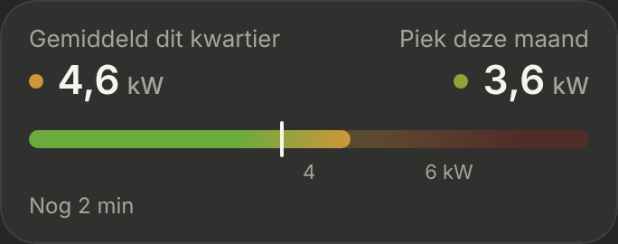
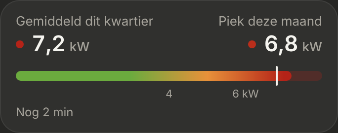

# Energie: Dit kwartier

The capaciteitstarief on the [Energie](../nav-categories/README.md) page, under [Nu](../energie-nu/README.md): the average of the current quarter-hour against this month's peak. Dark mode only.

> ✅ **Approved (K1, colours V2) and built** (3 November). Don't change proportions or behaviour without asking first.
>
> Code: `QuarterPeak.tsx` in `src/components/energy/`, `ENERGY_QUARTER` in `src/config/energy.ts`, styles under "Energie: Dit kwartier" in `src/styles.css`.

The options (K1: a bar with the month's peak, K2: a ring, K3: the last quarter-hours as bars): [`options.png`](./options.png) ([`options.html`](./options.html)). The colour bands, first hard: [`bands.png`](./bands.png) ([`bands.html`](./bands.html)), then blending, V1 and V2: [`mockup.png`](./mockup.png) ([`mockup.html`](./mockup.html)). As built (dev mode, mock values), normal and high:

## What the capaciteitstarief is

The digital meter takes the average power taken from the grid per quarter-hour (feeding back doesn't count). The highest quarter-hour of a month is that month's peak, at least 2.5 kW. The bill uses the average of the last 12 monthly peaks (a rolling window, nothing resets but the monthly peak on the 1st), times Fluvius' rate per kW per year. A single high quarter-hour raises that average by its difference divided by 12, for a year.

## Sources

The P1 meter's own figures (HomeWizard), in W, shown in kW with one decimal:

| In the card | Sensor |
|---|---|
| Gemiddeld dit kwartier | `sensor.p1_meter_average_demand`: the running average of the current quarter-hour |
| Piek deze maand | `sensor.p1_meter_peak_demand_current_month`: resets on the 1st |

Without either sensor there's no section. The peak has no time attribute, and `last_changed` would be wrong after an HA restart, so the card shows no date for the peak (a detailed graph can, later). The peak sensor has no `state_class`, so HA keeps no long-term statistics for it.

## The card (K1)

- **"DIT KWARTIER"** as the section title.
- **Two figures:** "Gemiddeld dit kwartier" on the left, "Piek deze maand" on the right, each with a **dot in the colour of its value**.
- **The bar** (10px, radius 5) runs to 8 kW, or further when a value is higher, so the colours stay in place. Along its whole length the colours are soft (25%); up to the current quarter-hour they're bright (V2: the bar shows the gradient as far as it reaches). A **white mark** is this month's peak: past it, this quarter-hour becomes a new peak.
- **Marks** under the bar at 4 and "6 kW".
- **"Nog 9 min":** minutes left in the quarter-hour, from the clock (quarter-hours end at :00, :15, :30 and :45), every minute.

## The colours

The owner's bands: good up to 4 kW, watch out from 4, too high from 6. Blending, so 4 and 6 kW sit halfway through each blend:

| kW | Colour |
|---|---|
| up to 3 | green `#6bab3e` |
| 3 → 5 | green blending to orange `#e8913a` |
| 5 → 7 | orange blending to dark red `#b42318` |
| from 7 | dark red |

Set in `ENERGY_QUARTER.colorStops`; the marks in `ENERGY_QUARTER.marksAtKilowatts`.
