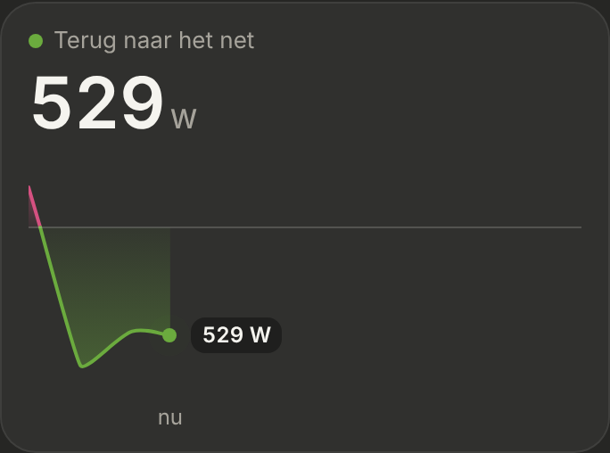
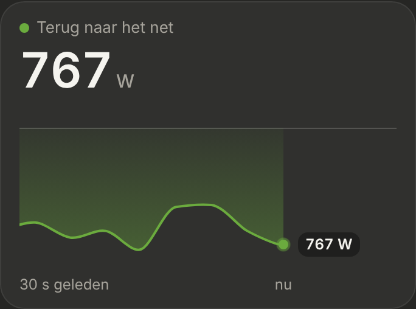

# Energie: Nu

The "Nu" section at the top of the [Energie](../nav-categories/README.md) page: what goes through the P1 meter right now, with a live line. Dark mode only. Built step by step; this is the first step.

> ✅ **Option B approved; step 1 built** (3 November): the label, the big number and the live line. Don't change proportions or behaviour without asking first.
>
> Code: `EnergyNow.tsx` in `src/components/energy/`, `src/config/energy.ts`, the hooks `useLivePowerSamples`, `useEasedNumber` and `usePrefersReducedMotion`, styles under "Energie: Nu" in `src/styles.css`.

The first options (A: flow diagram, B: big number with a live line, C: per phase): [`options.png`](./options.png) ([`options.html`](./options.html)). The approved live behaviour, animated with simulated values: [`mockup.html`](./mockup.html) (still: [`mockup.png`](./mockup.png)). As built (dev mode, the mock's wandering P1 value), growing, feeding back, and full:

## Source

Only the P1 meter: `sensor.p1_meter_power` (`ENERGY_NOW.gridPower`), positive while taking from the grid, negative while feeding back. Smappee isn't used here.

## The card

- **"NU"** with a green dot and "live" on the right.
- **The label:** "Van het net" with a pink dot (`#d55181`), or "Terug naar het net" with a green dot (`#6bab3e`), following the sign.
- **The big number** (40px, fixed-width digits), without a minus sign: it **counts** to each new value in 0.4 s.

## The live line

- **No history:** the line starts when the card appears, at the left edge, and is forgotten when you leave the page.
- **A point every 4 s,** with the meter's latest value. The meter reaches HA about every 3 s, so no value is taken twice.
- **It grows** until "nu" is at **70%** of the width, which takes **30 s**. From then on "nu" stays at 70% and the line **slides** left, 20 times a second; points older than 30 s are forgotten, except one just past the left edge so the line runs to it.
- **The end of the line is "nu":** the current value, easing to each new value like the big number. A pulsing dot sits on it, with the value in a small label beside it.
- **Pink above the zero line, green below,** meeting exactly on the zero line where the line crosses it. The fill is strongest along the line and fades towards zero.
- **The scale** always includes zero: only taking from the grid puts the zero line at the bottom. It eases to a new range instead of jumping. At least 300 W of range, so a steady low value isn't drawn as a mountain.
- **Under the line:** "30 s geleden" on the left (once full) and "nu" under the dot.
- **Reduce motion** (the device setting): no counting, no pulse, and the line moves once every 4 s instead of sliding.

## How it's drawn

ApexCharts (the area chart, as in the Verbruik tiles), with its own animation **off**: it animates each point by index, so with points dropping off the left the whole line would wobble. Instead the time window moves 20 times a second. Two series, one per colour, with a point at exactly zero where the line crosses it. The zero line, the dot, the pulse and the value label are HTML on top: ApexCharts' sparkline mode leaves out annotations, and the pulse would restart on every redraw.

## Next steps

The boxes under the line (Zon, Huis, Piek vandaag), "Dit kwartier", "Vandaag tot nu". For Zon: Smappee's production sensor, shown as stale when it hasn't changed for a long time in daylight.
