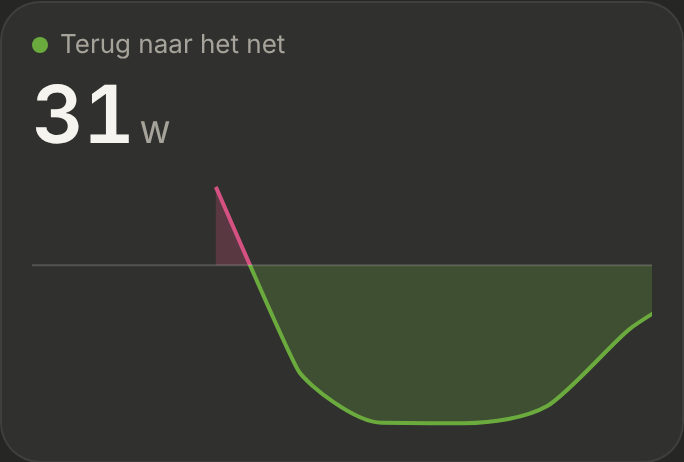
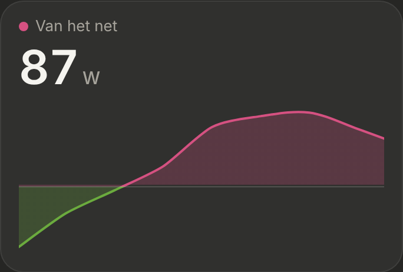

# Energie: Nu

The "Nu" section at the top of the [Energie](../nav-categories/README.md) page: what goes through the P1 meter right now, with a live line. Dark mode only. Built step by step; this is the first step.

> ✅ **Option B approved; step 1 built** (3 November), then **simplified** the same day: the line is drawn and scrolled entirely by ApexCharts. Don't change proportions or behaviour without asking first.
>
> Code: `EnergyNow.tsx` in `src/components/energy/`, `src/config/energy.ts`, the hooks `useLivePowerSamples`, `useEasedNumber` and `usePrefersReducedMotion`, styles under "Energie: Nu" in `src/styles.css`.

The first options (A: flow diagram, B: big number with a live line, C: per phase): [`options.png`](./options.png) ([`options.html`](./options.html)). The first live design, with "nu" at 70% and a dot on the line (built, then dropped for the simpler version): [`mockup.html`](./mockup.html) (still: [`mockup.png`](./mockup.png)). As built (dev mode, a mock value swinging between taking and feeding back):

## Source

Only the P1 meter: `sensor.p1_meter_power` (`ENERGY_NOW.gridPower`), positive while taking from the grid, negative while feeding back. Smappee isn't used here.

## The card

- **"NU"** with a green dot and "live" on the right.
- **The label:** "Van het net" with a pink dot (`#d55181`), or "Terug naar het net" with a green dot (`#6bab3e`), following the sign.
- **The big number** (40px, fixed-width digits), without a minus sign: it **counts** to each new value in 0.4 s.

## The live line

- **The last 30 s, a point every 4 s,** with the meter's latest value (it reaches HA about every 3 s, so no value is taken twice). It starts when the card appears; nothing is kept between visits.
- **The newest point at the right edge.** ApexCharts scrolls the line itself (`xaxis.range`): it recognises each update as a continuation of the previous one and slides it at constant speed over the 4 s until the next point.
- **Pink above the zero line, green below**, line and fill, through ApexCharts' threshold colours (`plotOptions.line.colors`); the fill is an even 25% tint.
- **The zero line** is an ApexCharts annotation. The scale always includes zero, with 10% room above and below.
- **No dot, value label or time labels** on the line: the big number shows the current value.
- **Reduce motion:** no counting; ApexCharts leaves out its own animations.

## Known limits

- **A big jump of the scale** (e.g. 200 W to 2 kW when a kettle switches on, and back when it scrolls out) is more than ApexCharts' scroll accepts (5×). That update morphs instead of sliding, once.
- **The first three points** are drawn without animation: ApexCharts recognises a scroll only from three points on.

## Next steps

The boxes under the line (Zon, Huis, Piek vandaag), "Dit kwartier", "Vandaag tot nu". For Zon: Smappee's production sensor, shown as stale when it hasn't changed for a long time in daylight.
