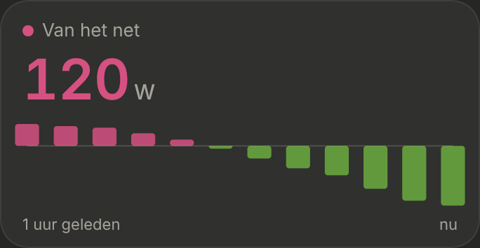

# Energie: Nu

The "Nu" section at the top of the [Energie](../nav-categories/README.md) page: what goes through the P1 meter right now, with a live line. Dark mode only. Built step by step; this is the first step.

> ✅ **Approved and built** (3 November): card B from [`without-chart.png`](./without-chart.png), with the 5-minute bars of [`graph-options.png`](./graph-options.png) (B2, but for the last hour). Don't change proportions or behaviour without asking first.
>
> Code: `EnergyNow.tsx` in `src/components/energy/`, `fetchFiveMinuteAverages` in `src/lib/statistics.ts`, `src/config/energy.ts`, the hooks `useEasedNumber`, `usePeriodicFetch` and `usePrefersReducedMotion`, styles under "Energie: Nu" in `src/styles.css`.

How it got here: the first options (A: flow diagram, B: big number with a live line, C: per phase): [`options.png`](./options.png) ([`options.html`](./options.html)). A live, animated line was built twice and dropped: the first live design is [`mockup.html`](./mockup.html) ([`mockup.png`](./mockup.png)). Then the card without a chart, A–D: [`without-chart.png`](./without-chart.png) ([`without-chart.html`](./without-chart.html)), and B with a graph, B1–B3: [`graph-options.png`](./graph-options.png) ([`graph-options.html`](./graph-options.html)).

## Source

Only the P1 meter: `sensor.p1_meter_power` (`ENERGY_NOW.gridPower`), positive while taking from the grid, negative while feeding back. Smappee isn't used here.

## The card (B)

- **"NU"** as the section title.
- **The label:** "Van het net" with a pink dot (`#d55181`), or "Terug naar het net" with a green dot (`#6bab3e`), following the sign.
- **The big number** (40px, fixed-width digits), without a minus sign, **in the colour of the bars**: pink while taking, green while feeding back. It **counts** to each new value in 0.4 s and follows every state change (about every 3 s).
- *No "Live" badge any more* (removed on 4 November at the owner's request).

## The bars

- **The last hour as 12 bars,** each the **average of 5 minutes**: HA's short-term statistics, what its history graph calls "5-minute aggregated" (time-weighted). Fetched with `recorder/statistics_during_period`, `period: '5minute'`, `types: ['mean']`.
- **Pink upwards** for taking from the grid, **green downwards** for feeding back, on a zero line. A 5 minutes with both nets out.
- **The newest bar is the last 5 minutes that are over;** the minutes still running are only in the big number.
- **Refreshed every minute** (`usePeriodicFetch`, also when the app comes back to the foreground), without animation. No subscription: HA has none for statistics, and HACS' apexcharts-card also fetches again, on every state change or a fixed `update_interval`.
- A 5 minutes without statistics (e.g. while HA restarted) is an empty slot.
- Under the bars: "1 uur geleden" and "nu". The bars run across the full width of the card, like the Verbruik tiles' lines.
- ApexCharts bar chart (`apexcharts/bar`, plus `apexcharts/features/annotations` for the zero line), each bar's colour set from its sign.

## Reduce motion

No counting.

## Next steps

The boxes under the line (Zon, Huis, Piek vandaag), "Dit kwartier", "Vandaag tot nu". For Zon: Smappee's production sensor, shown as stale when it hasn't changed for a long time in daylight.
