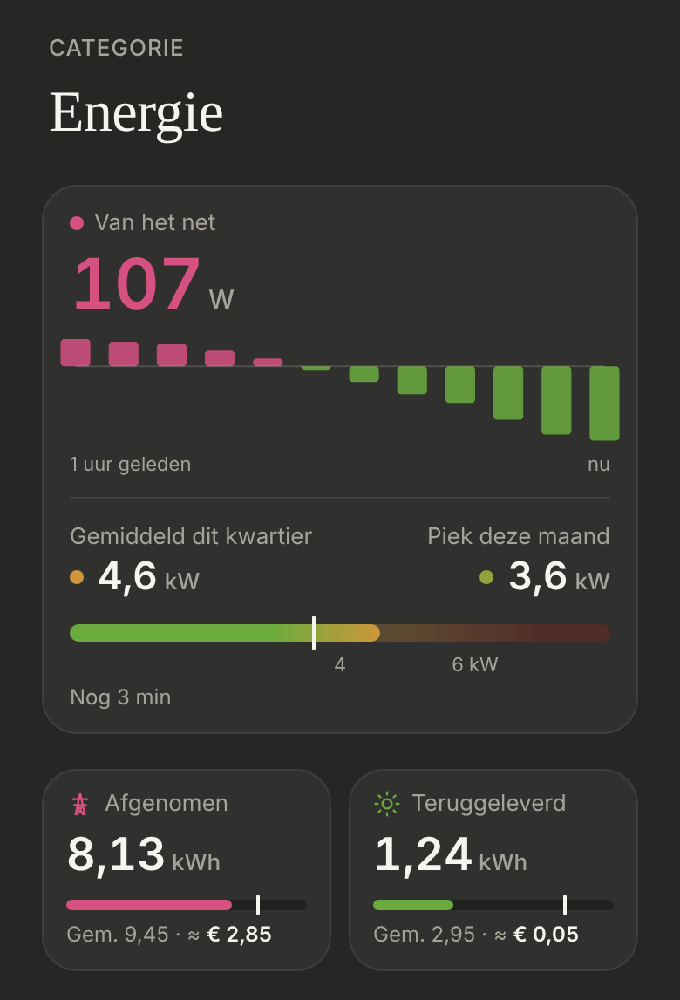

# Energie: the page

How the [Energie](../nav-categories/README.md) page is divided, without section titles. Dark mode only.

> ✅ **Approved (S2) and built** (4 November). Don't change proportions or behaviour without asking first.
>
> Code: `EnergyPage.tsx` in `src/components/energy/`, the `energy-card` and `energy-page__…` styles in `src/styles.css`.

The options (S1: no titles, S2: now in one card, S3: only "Vandaag", S4: a line between now and today): [`options.png`](./options.png) ([`options.html`](./options.html)). As built (dev mode, mock values):

## The layout (S2)

The section titles ("NU", "DIT KWARTIER", "VANDAAG TOT NU") are gone: each part already says what it is.

1. **One card for now:** [the power and its 5-minute bars](../energie-nu/README.md), a thin line (1px, the border colour), then [the quarter-hour](../energie-kwartier/README.md). The two parts are their own components (`EnergyNow`, `QuarterPeak`); only the card is shared. A part whose sensor is missing is left out, and so is the line; with neither, there's no card.
2. **The [day tiles](../energie-vandaag/README.md)** below it, 20px apart.
