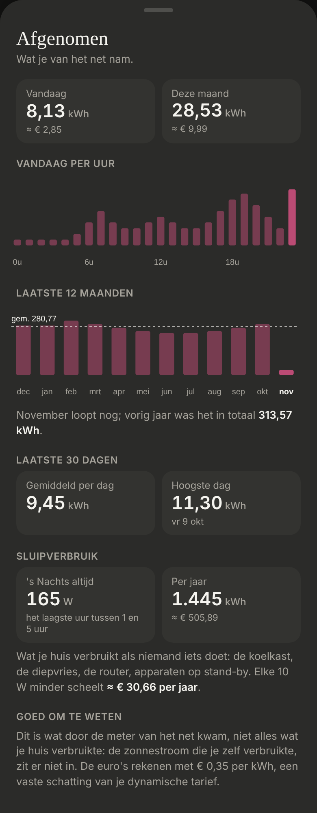
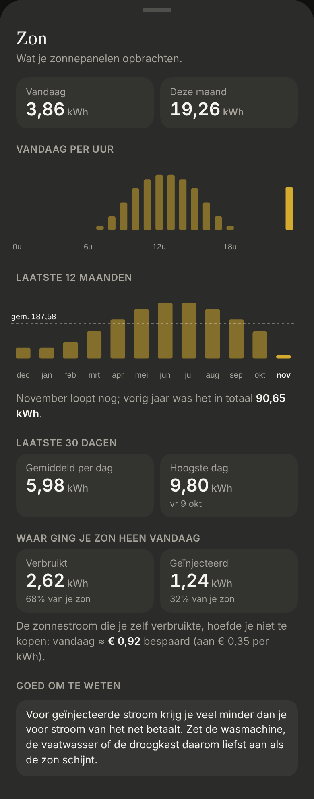
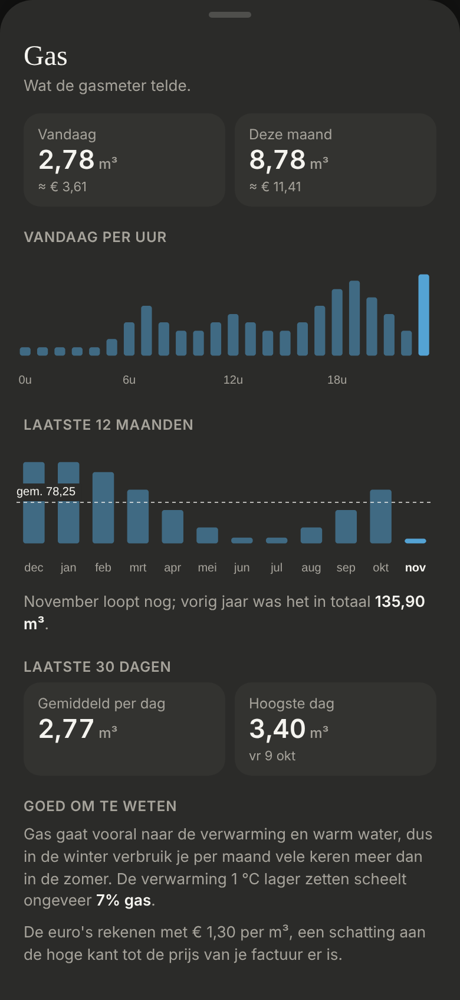
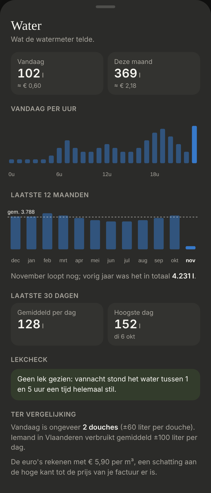

# Energie: the sheets behind the day tiles

A tap on a day tile on Energie opens a sheet with more about it: **Afgenomen**, **Zon**, **Gas** and **Water**. Dark mode only.

> 🛠 **Built without a design first**, at the owner's request ("no design, just build it; I'll review the code and app later"). Everything below is open to change.
>
> Code: `MeterSheet.tsx` (the shared sections), `InfoSheet.tsx` (the shared parts), `ElectricitySheet.tsx`, `SolarSheet.tsx`, `GasSheet.tsx` and `WaterSheet.tsx` in `src/components/energy/`; `DayTile`'s `onOpen`; `fetchHourlyTotalsToday`, `fetchEarlierMonthlyTotals`, `fetchLowestHourlyAverageLastNight` and `fetchHasCountedAllNight` in `src/lib/statistics.ts`; styles under "Info sheets" in `src/styles.css` (shared with the [Capaciteitstarief](../energie-capaciteit/README.md) sheet).

As built (dev mode, mock values):

| Afgenomen | Zon | Gas | Water |
|---|---|---|---|
|  |  |  |  |

## Opening

A tap anywhere on the day tile, like "Dit kwartier" opens the Capaciteitstarief: nothing on the tile shows it (`DayTile`'s `onOpen`).

## In every sheet (`MeterSheet`)

- **Vandaag** and **Deze maand**, with "≈ €" (not for Zon). This month = the days before today this month (daily statistics) + today's state.
- **Vandaag per uur:** 24 bars from midnight (hourly statistics, `change`); the current hour, which HA has no statistics for yet, is today so far minus the hours before it, in the full colour. Labels under 0u, 6u, 12u and 18u.
- **Laatste 12 maanden:** 11 months from the monthly statistics plus this month so far, with the average of the earlier months as a dashed line, and "November loopt nog; vorig jaar was het in totaal …" (the same month a year ago).
- **Laatste 30 dagen:** the average day and the highest day, with its date.
- A section that has no statistics yet is left out.

## Per sheet

- **Afgenomen** (`sensor.p1_meter_energy_consumption_daily`, pink):
  - **Sluipverbruik:** the lowest hourly average of the P1 meter last night (1:00–5:00), what the house always uses, with what that is per year in kWh and €, and what 10 W less saves per year. The P1 meter is net, but at night there's no sun, so that's the house.
  - **Goed om te weten:** this is what came from the grid, not all the house used (own solar isn't in it), and the € is a fixed estimate of the dynamic tariff.
- **Zon** (Smappee, yellow, no €):
  - **Waar ging je zon heen vandaag:** used and injected (the P1 meter), each with its share, and what the solar used yourself saved at the price of taking.
  - **Goed om te weten:** injecting pays far less; run the washing machine and the like while the sun shines.
- **Gas** (light blue): **Goed om te weten:** gas is mostly heating, so winter is many times summer; 1 °C lower saves about 7%; the € is an estimate.
- **Water** (blue, in litres):
  - **Lekcheck:** whether the meter counted in every 5 minutes of last night (1:00–5:00, short-term statistics): if so, an orange note that it may be a leak; if not, a green "Geen lek gezien". Left out when a 5 minutes is missing.
  - **Ter vergelijking:** today in showers (±60 l each) and the average person in Flanders (±100 l per day): rough figures, not measured.

## Assumptions to check

- The rough figures: 7% gas per °C, 60 l per shower, 100 l per person per day.
- Sluipverbruik takes the lowest hour; a fridge that cools all night is in it, a device that switches on now and then isn't.
- The leak check can miss a slow leak if the meter doesn't count it every 5 minutes.
