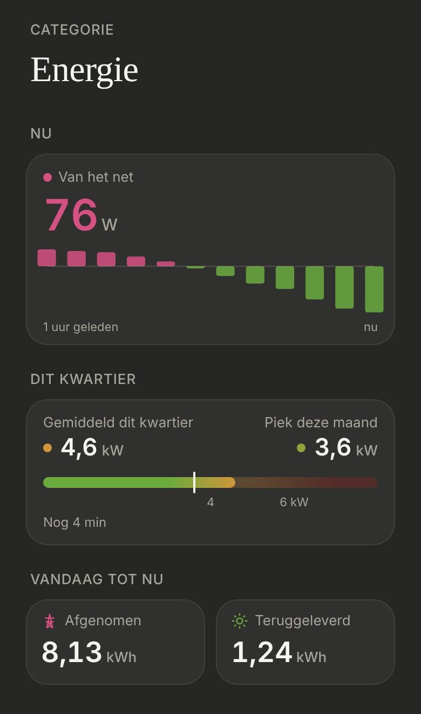

# Energie: Vandaag tot nu

What the P1 meter counted since midnight, on the [Energie](../nav-categories/README.md) page under [Dit kwartier](../energie-kwartier/README.md). Dark mode only.

> ✅ **Approved and built** (4 November): two tiles side by side, the **net** figures from the P1 meter, each as the shared [day tile](../day-tile/README.md) (D2): in euros and with the last 14 days. Don't change proportions or behaviour without asking first.
>
> **"Teruggeleverd vandaag" is replaced by "Zon vandaag"** ([energie-zon](../energie-zon/README.md)), which shows the feeding back as part of the solar. The rest below still holds for "Afgenomen vandaag".
>
> Code: `TodaySoFar.tsx` in `src/components/energy/`, `ENERGY_TODAY` in `src/config/energy.ts`, `DayTile`, the `pylon` icon in `Icon.tsx`.

The earlier options (A: three tiles, B: a list, C: a balance, D: four tiles with water): [`options.png`](./options.png) ([`options.html`](./options.html)). Instead, the owner chose two tiles, without gas or water, then the extra information of the day tile. As built (dev mode, mock values, placeholder prices):

## The tiles

| Tile | Icon | Sensor | Price |
|---|---|---|---|
| **Afgenomen** (taken from the grid) | pylon, blue `#4c9be8` (pink `#d55181` until 4 November) | `sensor.p1_meter_energy_consumption_daily` | what taking costs per kWh |
| **Teruggeleverd** (fed back) | sun, green `#6bab3e` | `sensor.p1_meter_energy_production_daily` | what feeding back earns per kWh |

- In kWh with two decimals, straight from the sensors' states (live). The colours are the ones of the Nu card.
- **Net, not gross:** what went through the meter, not what the house used or the panels made (that would need Smappee).
- **Full width**, one under the other, named "Afgenomen vandaag" and "Teruggeleverd vandaag", each with **the 13 days before today and today as bars**, and their average as a dashed line ([day tile](../day-tile/README.md), D2). From the daily statistics of the same sensors in HA (`ENERGY_TODAY.previousDays`), fetched again every 5 minutes. No chart while HA has no statistics yet.
- **"≈ € …":** today's kWh times `ENERGY_TODAY.euroPerKilowattHour`. **The price in the config is an approximation (€0,35, all-in at the higher price); Zon vandaag has no euros** ([energie-zon](../energie-zon/README.md)). An indication only: the bill also has fixed costs, the capaciteitstarief and taxes; a dynamic tariff isn't one price.
- Without either sensor there's no section.
- *No section title "Vandaag tot nu" any more:* since S2 ([energie-page](../energie-page/README.md)) the tiles sit under the card for now.
