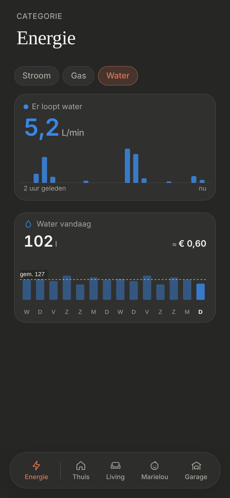

# Energie: Water

Water on the [Energie](../nav-categories/README.md) page, behind a **"Water" chip** after "Stroom" and "Gas" ([energie-gas](../energie-gas/README.md)). Built like Stroom, because the water meter has a live flow, like the P1 meter's power. Dark mode only.

> ✅ **Approved and built**: the owner chose Water as a mirror of Stroom, with the last 2 hours as bars. Don't change proportions or behaviour without asking first.
>
> Code: `EnergyPage.tsx` (the chips), `WaterNow.tsx`, `WaterToday.tsx` and the shared `FiveMinuteBars.tsx` in `src/components/energy/`, `ENERGY_WATER` in `src/config/energy.ts`, `fetchFiveMinuteStatistics` in `src/lib/statistics.ts`, the shared `DayTile`.

The approved mockup: [`mockup.png`](./mockup.png) ([`mockup.html`](./mockup.html)); the first ideas for the page: [`page-options.png`](./page-options.png) ([`page-options.html`](./page-options.html)). As built (dev mode, mock values):

## The card: now

- **The label:** "Er loopt water" with a blue dot while the flow is above 0, "Geen water" with a grey dot when it's 0.
- **The number:** the flow right now, one decimal, in the entity's own unit (`L/min`), blue while water runs and grey at 0. It counts to each new value, like Stroom's watts (not with reduced motion).
- **The bars:** the last 2 hours, **24 bars of 5 minutes**, each the litres used in those 5 minutes, in water blue. Axis labels "2 uur geleden" and "nu". The same bars as Stroom's (`FiveMinuteBars`, [energie-nu](../energie-nu/README.md)), fetched again every minute.
- **Source:** `sensor.garage_water_meter_water_usage` (the number) and the 5-minute `change` statistic of `sensor.garage_water_meter_consumption_daily` (the bars: how much the meter counted per 5 minutes; HA keeps these for 10 days).

## Water vandaag

- **One [day tile](../day-tile/README.md):** "Water vandaag" in litres (no decimals), droplet icon, with the 13 days before today and today as bars, a first letter per day and their average as a dashed line.
- **Water blue** `#3987e5` (`UTILITY_COLORS.water`), for the number, the bars and the tile.
- **Source:** `sensor.garage_water_meter_consumption_daily` (in m³, shown × 1000 as litres) and its daily statistics, fetched again every 5 minutes.
- **"≈ €":** today's m³ times `ENERGY_WATER.euroPerCubicMetre`, for now an **estimate on the high side, €5,90 per m³** (Flemish water, all-in with the sanitation charges) until the price on the bill replaces it.
