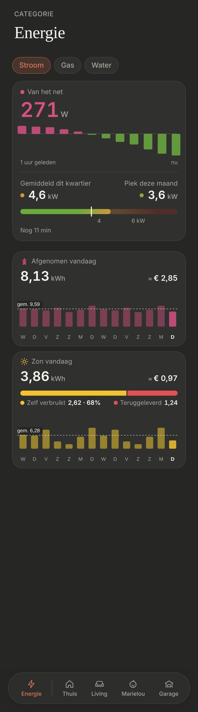

# Energie: Zon vandaag

The solar panels on the [Energie](../nav-categories/README.md) page, under **Stroom**: one day tile, "Zon vandaag", in place of "Teruggeleverd vandaag". Dark mode only.

> ✅ **Approved (B, only its bottom tile) and built.** The owner chose to keep Stroom's card as it is ("way too much" with the solar figures added), and only to replace "Teruggeleverd" with "Zon vandaag". Don't change proportions or behaviour without asking first.
>
> Code: `TodaySoFar.tsx` in `src/components/energy/`, `ENERGY_TODAY` in `src/config/energy.ts`, `DayTile` (its `children` and `earlierDaysColor`), styles under "Zon vandaag" in `src/styles.css`.

The options under Stroom (A to C; B's bottom tile was chosen): [`options.png`](./options.png) ([`options.html`](./options.html)). Before that, Zon as a chip of its own (Z1 to Z3), which the owner didn't want: [`chip-options.png`](./chip-options.png) ([`chip-options.html`](./chip-options.html)). As built (dev mode, mock values):

## The tile

- **The shared [day tile](../day-tile/README.md):** "Zon vandaag", sun icon, in kWh with two decimals, with the 13 days before today and today as bars and their average.
- **Yellow** `#f2c230`; the earlier days in a darker solid yellow `#a8902f` (the usual 45% of the colour looks olive on the dark card).
- **The split**, between the value and the chart: one bar, yellow for what the house used itself, **red** `#e05252` for what went back to the grid (the owner's choice: feeding back is bad for you, so not green), as wide as their shares. Under it "Verbruikt 2,62 · 68%" and "Teruggeleverd 1,24". Not shown while the panels made nothing yet today.
  - Used yourself = solar − fed back, never below 0 (Smappee and the P1 meter measure apart).
- **"≈ €":** used yourself × the price of taking (€0,35, what it saved) + fed back × the price of feeding back (still the €0,04 placeholder).
- **Source:** `sensor.garage_smappee_total_production_today` (Smappee; Wh or kWh, its unit decides) with its daily statistics, and `sensor.p1_meter_energy_production_daily` (the P1 meter's feeding back), fetched again every 5 minutes.
- Without either sensor, there's no Zon tile; "Afgenomen vandaag" stays.
