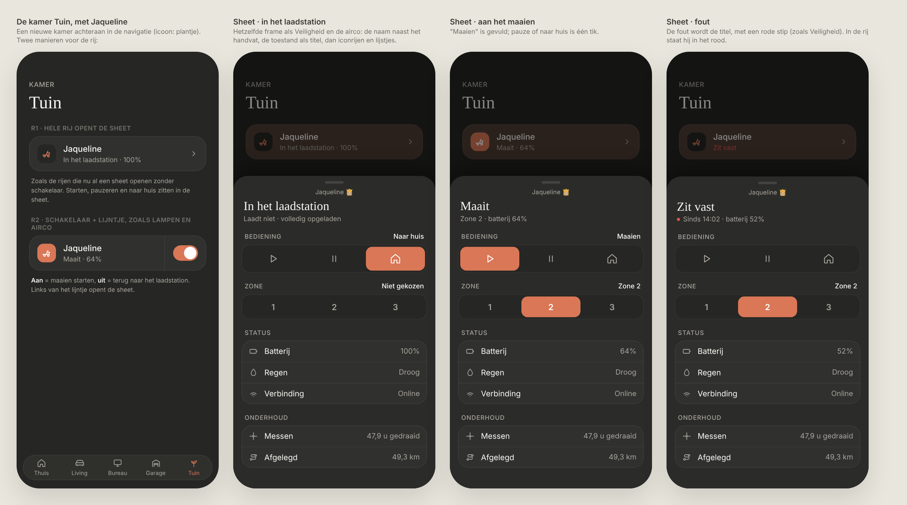
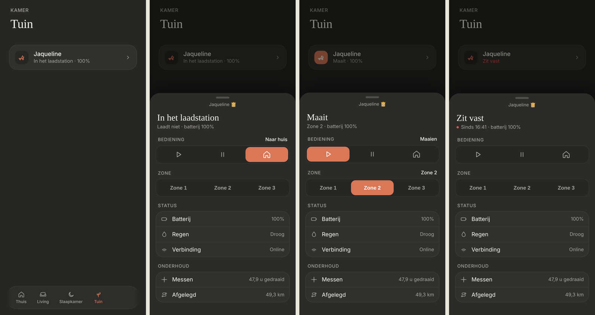

# Lawn mower: the Tuin room and Jaqueline's sheet

A new room, Tuin, with the robot lawn mower (Worx Landroid, via Landroid Cloud) as its only control. Tapping it opens a sheet with everything she can do. Dark mode only. Built from parts that already exist: the room page, the shared `BottomSheet`, the airco sheet's icon rows (now the shared `ChoiceRow`) and the Veiligheid list.

> ✅ **Approved (row option R1) and built.** Don't change proportions or behaviour without asking first.
>
> Code: `MowerSheet` in `src/components/MowerSheet.tsx`, states and HA calls in `src/lib/mower.ts`, the row in `RoomView.tsx`, the config under `mower` in `src/config/rooms.ts`.



Source: [`mockup.html`](./mockup.html). As built (dev mode, mock data): the room, docked, mowing in zone 2, and stuck:



## The room

- **"Tuin"** at the end of the bottom nav, with the plant icon (`sprout`).
- **One row (R1):** the mower icon, "Jaqueline", and her state with the battery ("In het laadstation · 100%", "Maait · 64%"). With an error, the second line is the error in red ("Zit vast"). A chevron on the right; **tapping anywhere on the row opens the sheet**. There's no switch.

## The sheet

- **The shared frame**, at most **80% of the screen high**. The handle stays in place; the content scrolls under it.
- **"Jaqueline 👸🏼" next to the handle** (her `friendly_name`).
- **Title:** her state ("In het laadstation", "Maait", "Gepauzeerd", "Keert terug"), or the error ("Zit vast"). **Below it:** a short line, e.g. "Laadt niet · batterij 100%", "Voortuin · batterij 64%", or "Sinds 14:02 · batterij 52%" with a red dot for an error.
- **Bediening:** the airco's icon row with Maaien (▶), Pauze (Ⅱ) and Naar huis (⌂). What she's doing now is filled. *Decision during the build:* Maaien and Pauze are **permanently disabled** (dimmed, not tappable, hard-coded in the sheet): from the dashboard she can only be sent home (`lawn_mower.dock`). They still fill to show that she's mowing or paused.
- **Status:** the Veiligheid list with Zone (the active zone's name from the config), Batterij (with "laadt op" while charging), Regen (Droog / Nat) and Verbinding (Online / Offline). *Decision during the build:* the zone was a row of buttons; it's **only shown**, because Landroid Cloud can't choose a zone for RTK/Vision mowers yet ("Zone selection for RTK/Vision devices is not supported yet"). Without an active zone (`unknown`), the line is left out.
- **Onderhoud:** blade hours since the last reset, and the total distance driven.
- **"Wacht op droog weer"** (`rain_delay`) is a state, not an error: no red.

## Config

Everything is listed explicitly on the control; nothing is found automatically. Leave an entity out to hide its line.

```ts
{
  entity: 'lawn_mower.…_jaqueline',
  name: 'Jaqueline',
  mower: {
    zone: 'select.…_zone',
    zones: [{ option: '1', name: 'Voortuin' }, { option: '2', name: 'Achtertuin' }],
    battery: 'sensor.…_battery',
    charging: 'binary_sensor.…_charging',
    rain: 'binary_sensor.…_rain_sensor',
    online: 'binary_sensor.…_mqtt',
    error: 'sensor.…_error',
    bladeHours: 'sensor.…_blade_runtime_since_reset',
    distance: 'sensor.…_distance_driven_total',
  },
}
```

## Not chosen

- **R2 · switch and divider** (on = start mowing, off = back to the dock), like the lights and the airco. For a mower, "off" meaning "go home" is less obvious, and easy to tap by accident.
