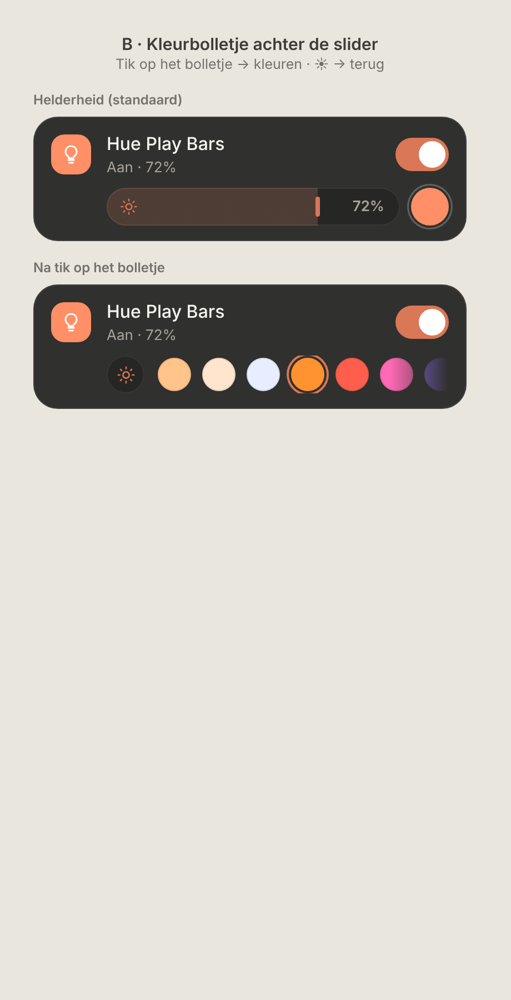

# Light controls: brightness or colour on one row

How a dimmable colour light looks on a room page. Dark mode only. It builds on the current room rows (`src/components/RoomView.tsx`, `BrightnessSlider`, `ColorPicker`).

> ✅ **Approved (option B), not built yet.** The owner chose this design. Build it as described, and don't change proportions or behaviour without asking first.

Source: [`mockup.html`](./mockup.html) (a static mockup; open it in a browser, not part of the build).

## Problem

A colour light currently takes two extra lines below its row: the brightness slider, plus the colour swatches. On a room with several lights that gets long.

## Design: a colour dot at the end of the slider

Below the light's row there is **one** control row (34px high, same indent as today):

| State | Row contents |
|---|---|
| **Brightness (default)** | The brightness slider, almost full width. At its end, a **colour dot** (34px round) filled with the light's current colour, with a thin ring to set it off from the card. |
| **Colour** (after tapping the dot) | A **☀ button** (34px round, `--bg` background, accent icon), then the existing single scrollable row of swatches (with the fades on the side(s) that have more). |

- **Tap the colour dot** to switch the row to the swatches.
- **Tap ☀** to switch back to the slider.
- **Picking a swatch** works as today. The row stays on colour until you tap ☀ or leave the page.
- **No memory:** each time the page opens, every light starts on brightness. Nothing is remembered per light.
- **Switching** is instant, with at most a short crossfade. The row's height never changes, so the page doesn't jump.

## Which lights get what

| Light supports | Row |
|---|---|
| On/off only | No control row (as today) |
| Brightness only | Slider only, no colour dot |
| Brightness + colour and/or colour temperature | Slider + colour dot (this design) |
| Colour temperature only | Same, but the swatches are only warm / neutral / cool white |

The colour dot shows `rgb_color`. HA also reports that in colour-temperature mode, so the dot always matches what the light shows.

## Not chosen

- **A · Segment switch** (☀ / colour wheel in front of the row): always visible, but it makes the slider noticeably shorter.
