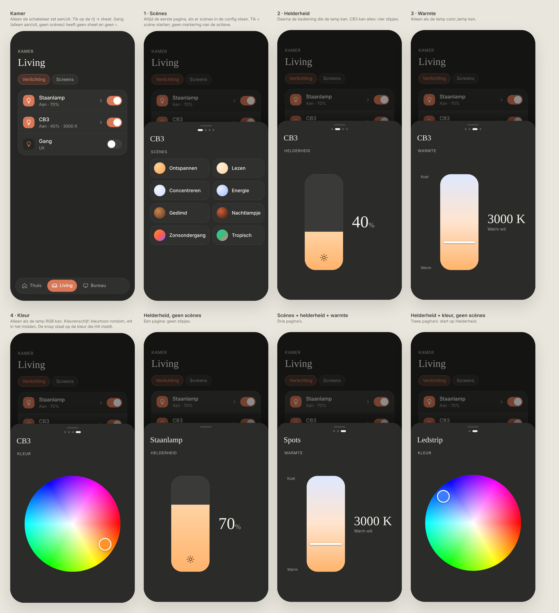
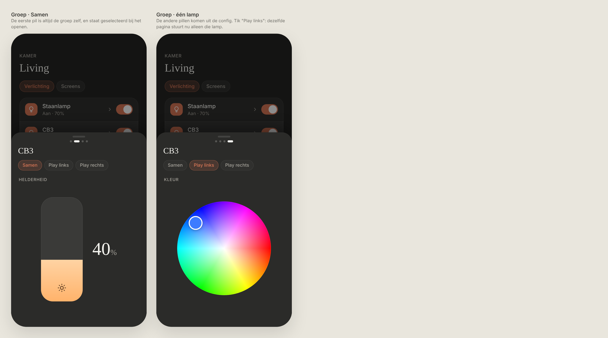

# Light sheet: controls in a bottom sheet

How lights are controlled on a room page. Dark mode only. Replaces [`light-controls`](../light-controls/README.md) (option B, never built).

> ✅ **Approved, not built yet.** Don't change proportions or behaviour without asking first.



Source: [`mockup.html`](./mockup.html).

## The row

- No controls under the row anymore: every light is one row.
- **Only the switch** turns the light on and off. Tapping the rest of the row **opens the sheet**.
- The row shows it opens a sheet with a small **"›" at the end of the detail line** ("Aan · 69% · 3676 K ›"), in the same muted colour (option D in [`row-hint-options.png`](./row-hint-options.png); not chosen: a divider, a sliders button, a brightness bar).
- With nothing to show (only on/off, no scenes), tapping does nothing and the row has no "›".
- Detail line: "Aan · 40%", plus the kelvin in white mode: "Aan · 40% · 3000 K". In colour mode HA reports no kelvin, so it stays "Aan · 40%". No colour names: the dashboard doesn't guess.

## The sheet

- Opens from the bottom over the dimmed page; swipe down or tap beside it to close (like the expanded player).
- Only the light's name (serif), the page dots, the page heading and the control. **No subtitle, no on/off button, no page names.**
- Pages, swiped sideways like Chromecast ↔ Sonos, in this order and **only when available**:

| # | Page | When | Control |
|---|---|---|---|
| 1 | **Scènes** | The light has a `scenes` list in the config | Tiles, two per row: colour circle + name. Tap = start the scene. No "active" highlight (HA can't tell reliably). |
| 2 | **Helderheid** | The light supports brightness | Vertical slider (iOS Control Center style) with the percentage next to it |
| 3 | **Warmte** | The light supports `color_temp` | Vertical slider, warm (bottom) to cool (top), value in kelvin with a name ("3000 K · Warm wit") |
| 4 | **Kleur** | The light supports a colour mode (hs/xy/rgb) | Colour disc (option A): hue around, white in the middle to full colour at the edge. The knob sits on the colour HA reports and takes that colour. |

- One page: no dots. No pages at all: no sheet.
- Vertical sliders, so dragging a slider can't be confused with swiping between pages.

## Groups

A light group (e.g. CB3 = two Hue Play bars) is **one row** on the room page; its switch turns the whole group on and off. In the sheet, **pills** under the name choose what the pages control:



Source: [`group.html`](./group.html). The mockup still shows a "Samen" pill; that was dropped (see below).

- **Pills are the individual lights only**, configured by hand (`members`), in that order. The first is selected when the sheet opens. *Changed during the build:* a "Samen" pill for the group itself was dropped. A HA light group reports the average of its members, so while they update one after the other its kelvin is a value no light has, and the knob jumped (HA's own control does the same).
- A pill whose light can't do the current page is **dimmed**, from that light's own `supported_color_modes`.
- **On/off is always the group:** the row's switch. No switch per light, no "Lampen" page.
- Without `members`, there are no pills.

## Config

Scenes are listed explicitly per light, in display order:

```ts
{
  entity: 'light.huecupboard',
  name: 'CB3',
  scenes: ['scene.cb3_ontspannen', 'scene.cb3_lezen'],
  members: [
    { entity: 'light.play_links', name: 'Play links' },
    { entity: 'light.play_rechts', name: 'Play rechts' },
  ],
}
```

Colour picker: [`@uiw/react-color-wheel`](https://www.npmjs.com/package/@uiw/react-color-wheel) (MIT), styled to match. It works in hue/saturation, like HA's `hs_color`.

## Not chosen

- Horizontal sliders (B): clash with swiping between pages.
- Page names above the title, an on/off button and a subtitle in the sheet: dropped (KISS).
- Colour swatches on the Kleur page, and a ring (B) instead of a disc ([`color-picker-options.png`](./color-picker-options.png)): the disc matches the HA and Hue apps.
- A "Lampen" page with a switch per member light: on/off is always the whole group.
- Colour names on the row ("Aan · 40% · Amber"): that would be a guess.
