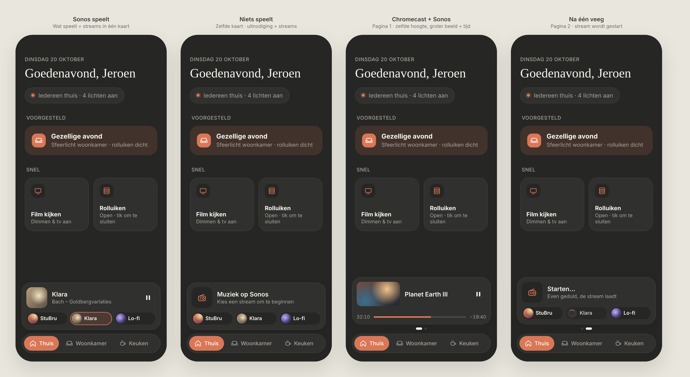
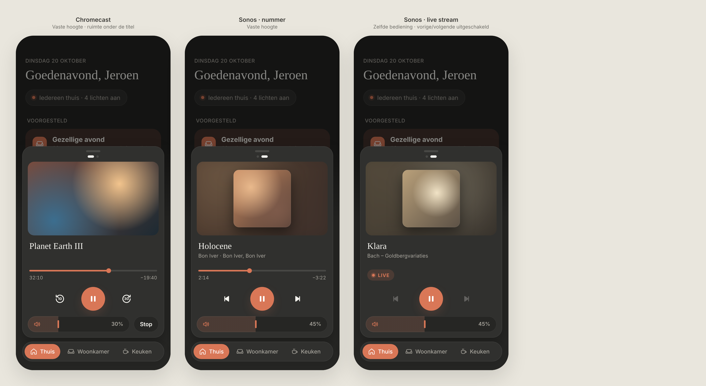
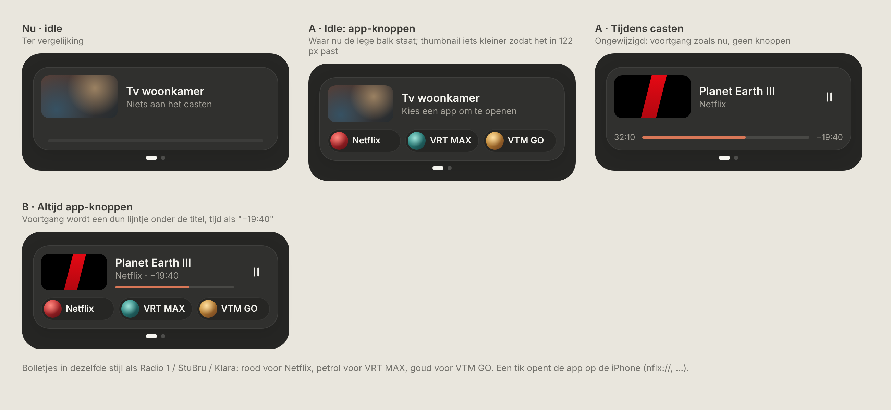

# Media card

One card on **Thuis** for all media: Sonos and Chromecast, plus stream buttons that start Home Assistant scripts. Dark mode only.

| Part | Status |
|---|---|
| [Mini player](#mini-player--approved-final) | ✅ **Approved: final.** Build exactly as designed. |
| [Expanded player](#expanded-player--approved-final) | ✅ **Approved: final.** Build exactly as designed. |
| [App buttons on the Chromecast page](#app-buttons-on-the-chromecast-page--approved-built) | ✅ **Approved (option A) and built.** |

---

## Mini player: approved, final

> ✅ **This design is final.** The owner approved it as perfect. Don't change proportions, spacing or content without asking first.

Source: [`mini-player.html`](./mini-player.html) (a static mockup; open it in a browser, not part of the build).

### Placement

- Only on **Thuis**, docked directly above the bottom navigation. It never appears on room pages.
- The card has one **page per device**. With two pages, you swipe horizontally between them.

### Pages

**Sonos page** (always present: it's also how you start music)

| Row | Playing | Idle |
|---|---|---|
| Top | Cover (54px, radius 14) · station/title (16px, 600) · current track (13px, muted) · pause button | Radio icon tile (54px) · "Muziek op Sonos" · "Kies een stream om te beginnen" |
| Bottom | Stream buttons (no active highlight, see Decisions) | Stream buttons |
| While starting | n/a | Top row reads "Starten…" / "Even geduld, de stream laadt"; the tapped button shows a spinner instead of its logo |

**Chromecast page** (only while something is casting)

- Top: a 16:9 thumbnail (112×63, radius 12), the **title only** (up to 2 lines; no app, episode or TV name), and a pause button.
- Bottom: a progress bar with times (`32:10 ─── −19:40`).

### Stream buttons

- Pills 34px high: a colored dot "logo" (26px, gradient), then a short name in 13px/600. 6px gap; they share the width equally.
- A tap calls `script.turn_on` for that stream's script (fire and forget). The spinner shows until the Sonos reports `playing`, and gives up after about 10 s with "Dat lukte niet".
- Configured in code, e.g. `{ script: 'script.sonos_klara', name: 'Klara', color: … }`.

### Dimensions

- Card: padding 12px, radius 24px, 10px between rows, **fixed height 122px for every page**, so swiping never changes the height.
- Below the card: page dots (6px; the active one is a 16px pill). They're only shown when there are 2 pages.

### Swiping

- The card follows your finger, then always **snaps to a whole page**: past about ⅓ of the width or with a quick flick it moves to the next page, otherwise it springs back. It never rests halfway and moves one page per swipe.
- Implementation: CSS `scroll-snap-type: x mandatory` and `scroll-snap-stop: always`.

### Which pages are shown

| Chromecast | Sonos | Pages |
|---|---|---|
| idle | idle | Sonos (idle + streams), no dots |
| playing | idle | Chromecast ⇄ Sonos (idle + streams) |
| idle | playing | Sonos (playing + streams), no dots |
| playing | playing | Chromecast ⇄ Sonos (playing + streams) |

The device that started most recently is the first page. "Playing" includes paused.

### Interactions

- Tapping the top row opens the **expanded player** for that device.
- Pause/play in the card works directly, without opening anything.

---

## Expanded player: approved, final

> ✅ **This design is final.** The owner approved it. Don't change proportions, spacing or content without asking first.

Source: [`expanded-player.html`](./expanded-player.html) (a static mockup; open it in a browser, not part of the build).

### Behaviour

- **Opening:** tap the top row of the mini player. The card expands in place above the bottom navigation, and the rest of the page dims.
- **Closing:** swipe down on the grab handle (a 36×5px pill, centred at the top), or tap the dimmed page. There's no close button.
- **Page dots** sit under the handle when there are 2 devices. You swipe horizontally between Chromecast and Sonos with the same snapping as the mini player: always a full page, never halfway.
- **Fixed height of 483px for every card** (Chromecast, Sonos track, Sonos stream), so swiping never changes the height. The rows are fixed: image, title block (min 52px), progress slot (44px), controls (60px), and a footer row for volume.

### Rows, top to bottom

| Row | Chromecast | Sonos · track | Sonos · live stream |
|---|---|---|---|
| Image (16:9, radius 16) | Thumbnail fills the area | Square cover (78% of the height, radius 14) centred on a blurred, darkened copy of itself | Same as track |
| Title block | Title only (serif, 22px), with empty space below | Title + `artist · album` (13px, muted) | Station + current programme/track |
| Progress slot | Progress bar + `32:10 / −19:40` | Progress bar + times | **"● LIVE" pill** (accent tint) instead of the bar |
| Controls | −10 s · **play/pause** · +30 s | previous · **play/pause** · next | previous · **play/pause** · next, with **previous/next disabled** (25% opacity, not tappable) |
| Footer | Volume pill + **Stop** button | Volume pill (full width) | Volume pill (full width) |

- Play/pause is a 60px accent circle, in exactly the same place on every card.
- No shuffle, no repeat, no stream buttons (those live in the mini player).
- Previous/next are disabled based on the player's `supported_features`, not on hard-coded stream logic.

### Home Assistant mapping

| UI | HA |
|---|---|
| Title / subtitle | `media_title`; `media_artist`, `media_album_name` (Sonos) |
| Image | `entity_picture` (prefix with the HA URL in dev) |
| Progress | `media_position`, `media_duration`, `media_position_updated_at` (extrapolate while playing); no duration means live |
| Play/pause | `media_player.media_play_pause` |
| Previous / next (Sonos) | `media_player.media_previous_track` / `media_next_track`; enabled only if `supported_features` allows it |
| −10 / +30 s (Chromecast) | `media_player.media_seek` to position ∓ 10 / + 30; hidden if seeking isn't supported |
| Volume | `volume_level`; `media_player.volume_set`, debounced like the brightness slider |
| Stop (Chromecast) | `media_player.media_stop` |

---

## App buttons on the Chromecast page: approved, built

> ✅ **Approved (option A) and built** (`CAST_APPS` in `src/config/media.ts`, `CastPage.tsx`). Don't change proportions or behaviour without asking first.
>
> *Decisions during the build:* the link is opened with `window.open(url)`, the same way HA's own `url` tap action does it. Each app has its house colour (`color`), from which the colour circle is built (Netflix `#e50914`; VTM GO a gradient like its icon: `#e555d9` → `#fa077e` → `#f73849` → `#ff8518`; VRT MAX coral red with a touch of navy: `#ff6a6d` → `#ff4b4f` → `#1b1d52`, from its logo); without one they go by position (red, teal, gold). Netflix (`nflx://`) is the first app.

Source: [`cast-apps.html`](./cast-apps.html). The approved screens are **"A · Idle"** and **"A · Tijdens casten"**; "B" was not chosen.

- **Only while nothing is casting.** The app buttons take the place of the empty, dimmed progress bar of the idle Chromecast page. The subtitle reads "Kies een app om te openen". While something is casting, the page is unchanged: progress bar or LIVE pill, no buttons.
- **Same pills as the Sonos stream buttons:** 34px high, a 26px colour circle (same 3D gradient style, **no logos**), a short name in 13px/600, equal width, 6px gap.
- **Idle thumbnail 96×54** (instead of 112×63) so the buttons fit the fixed 122px card. While casting it stays 112×63.
- **A tap opens the app on the iPhone** through its URL scheme (e.g. `nflx://`), not on the TV. Light haptic tick on tap. Nothing to wait for, so no spinner and no "Dat lukte niet".
- **Config** in `src/config/media.ts`, e.g. `CAST_APPS = [{ name: 'Netflix', url: 'nflx://' }, { name: 'VRT MAX', url: '…' }, { name: 'VTM GO', url: '…' }]`. Up to 3 apps.
- **Colours:** red for Netflix, teal blue for VRT MAX, gold for VTM GO in the mockup.
- **Open before building:** confirm that the HA Companion app hands `nflx://`-style links to iOS (test with a Button card, `tap_action: action: url, url_path: nflx://`), and find the URL schemes for VRT MAX and VTM GO. Fallback if links don't work: an iOS Shortcut per app (`shortcuts://run-shortcut?name=Netflix`), same buttons.

## Decisions during the build

- **No active-stream highlight.** The owner doesn't need it, so the stream buttons never get an "active" outline. This intentionally deviates from the mockup.
- **Button labels are the scripts' names in HA** (`friendly_name`). The config only lists script entity IDs (`src/config/media.ts`).
- **The Chromecast page is always present** next to the Sonos page, even when nothing is casting. So there are always 2 pages with dots once a Chromecast is configured. This replaces the "only while something is casting" rule and the page-order table above.
  - **Idle:** the colour fade (dimmed), the TV's name, "Niets aan het casten", and an empty dimmed progress bar.
  - **Order is fixed:** Chromecast first, then Sonos. It never reorders, which replaces the "most recently started first" rule.
- **No image from the cast app → the colour fade**, never a TV icon.
- **The cast app's name sits under the title** ("VRT MAX", "Netflix") in muted text, on both the small and the large card. It comes from `app_name`. This replaces "title only". The generic "Default Media Receiver" is left out, and the episode and TV name are still not shown.
- **Casting** means `playing`, `paused` or `buffering`, and not the "Backdrop" ambient screen. With no `media_duration` (live TV), the progress row shows a "● LIVE" pill.
- **Built:** the mini player and the expanded player, both with Chromecast and Sonos pages.
- **Idle pages in the expanded player:** the same layout as an active page, with the dimmed colour fade, "Niets aan het casten" / "Niets aan het spelen", an empty progress bar and a disabled play button. Volume still works.
- **No image → colour fade** everywhere. For Sonos it's a faded square on a blurred fade, the same build as a real cover.
- **Previous/next and ±10/30 s** are enabled only when `supported_features` allows them *and* there's a duration. You can't skip in a live stream, even if the player claims it can. If seeking isn't supported at all, ±10/30 s are hidden but keep their space.
- **Closing returns to the same page:** the mini player shows the device that was last in view in the expanded player.

## Open questions

- **Entity IDs:** the owner fills in the Sonos and Chromecast entities in `src/config/media.ts`.
