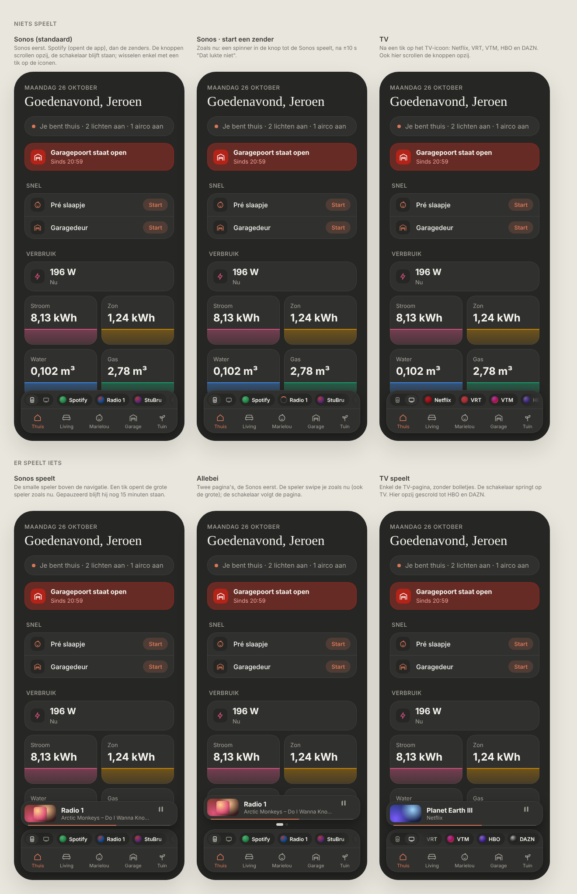

# Media dock: shortcuts in the navigation

The media card on Thuis takes less room. The app and station shortcuts sit in a row on top of the bottom navigation, and the mini player only shows while something plays, as a slim player. Dark mode only. Changes the [media card](../media-card/README.md).

> ✅ **Approved (option J) and built.** Don't change proportions or behaviour without asking first.
>
> Code: `MediaShortcuts` (the row), `MiniPlayer` and `MiniPlayerPage` (the slim player) in `src/components/media/`, `useStationStart` in `src/hooks/`, `isSonosShown` in `src/lib/media.ts`, the shortcuts in `MEDIA` (`src/config/media.ts`).

Source: [`mockup.html`](./mockup.html). How we got there: [`options.html`](./options.html) / [`options.png`](./options.png) (G and H were not chosen).

## Why

The idle card (122px plus page dots) sat above the navigation all the time and covered half of Verbruik, while its top row ("TV op Chromecast · Kies een app om te openen") said nothing the buttons didn't. The shortcuts are used a lot, so they stay one tap away.

## The row in the navigation

- **Only on Thuis.** On room pages the navigation stays as it is.
- **Part of the navigation:** the same surface, on top of the rooms, with a hairline between them.
- **Left: a Sonos | TV switch** (two icons in a small segmented pill). **Only a tap switches**; swiping the row only scrolls the shortcuts.
- **The Sonos comes first:** on the left of the switch, and the device the row starts on.
- **Right: that device's shortcuts, scrolling sideways**, each as wide as its name, with a soft right edge. Chips 28px high, a 16px colour circle (a bit darker, like before) and the name in 12px/600.
  - **Sonos:** Spotify first, then Radio 1, StuBru, Tijdloze.
  - **TV:** Netflix, VRT, VTM, HBO, DAZN.
- **An app** (Spotify, Netflix, …) opens on the iPhone through its URL scheme, the same way HA's own `url` tap action does it.
- **A station** starts its script on the Sonos: a spinner in the chip until the Sonos plays something new; after 10 s without it, the chip says "Dat lukte niet" for 3 s. While one starts, the other stations are dimmed.

## The mini player: only while something plays

- **A slim player above the navigation**, 56px: picture (72×40; the device's colour fade with album art square in the middle when there's no video image), title, app or track below it, play/pause, and a thin progress line along the bottom edge when there's a length.
- **Tap the picture or title** to open the expanded player, as before. Play/pause works directly.
- **One page per playing device, the Sonos first.** With two, you swipe between them with page dots below; the expanded player also has the Sonos first.
- **The switch follows the page in view.** When only the TV plays, it's on TV.
- **A device that starts playing comes into view**, e.g. after tapping a station while the TV plays.
- **When it shows:**
  - **Chromecast:** `playing`, `paused` or `buffering`, and not the "Backdrop" screen.
  - **Sonos:** `playing`; `paused` only for **15 minutes** after the pause (the state's `last_changed`). A Sonos hardly ever goes idle by itself, so "paused" alone would keep the player up for days. The dashboard checks this every minute (`useNow`). After an HA restart a paused Sonos shows another 15 minutes, because HA resets `last_changed`.
- **Nothing playing → no player**, only the row.

## Replaces in the media card

The mini player's 122px card with its idle pages, its stream and app button rows, and its progress row with times (the times stay in the expanded player). The expanded player is unchanged, apart from the Sonos coming first.

## Open before using

- **App links for HBO and DAZN** (`hbomax://`, `dazn://`) and **Spotify** (`spotify://`) are untested on the iPhone, like VRT and VTM were. If one doesn't open its app, change its `url` in `MEDIA` (`src/config/media.ts`).
- **The colours for HBO, DAZN and Spotify** were picked for the design, not taken from a house colour.
