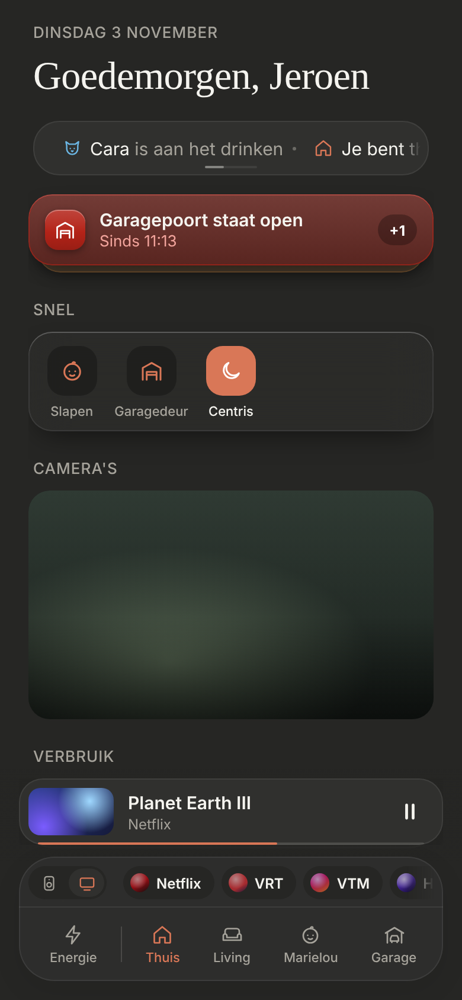
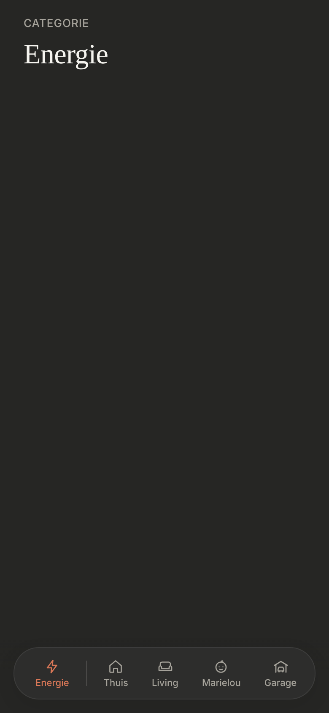

# Category pages in the bottom bar

Pages about the whole house (for now only **Energie**) next to the room pages, in the same bottom bar: categories to the left of Thuis, rooms to the right. Dark mode only. Builds on the [bottom nav](../bottom-nav/README.md).

> ✅ **Approved (option A) and built** (3 November). Don't change proportions or behaviour without asking first.
>
> Code: `src/config/categories.ts`, `CategoryPage.tsx`, the categories in `BottomNav.tsx`, page switching in `App.tsx`, `.bottom-nav__divider` in `src/styles.css`.

The options (A: one category at the front; B: several, peeking in from the left; C: in their own group; D: as icons): [`options.png`](./options.png) ([`options.html`](./options.html)). The page content in those mockups is a placeholder. As built (dev mode, mock data):





## The bar (A)

- **Categories first,** in the order of `src/config/categories.ts`, then a **thin line** (1px, 30px high), then Thuis and the rooms as before.
- **Thuis stays the start page.** The bar opens at its start, so Energie is visible; nothing is hidden to the left.
- A category is an ordinary bar item: icon and name, orange when you're on it.
- **Option C** (the categories in their own outlined group) is the plan once there's a second category.

## Switching

- Pages slide in from the side they're on in the bar: a category from the left, a room from the right, as before.
- **The mini player and the media shortcuts** stay on Thuis only, as on the room pages.

## The category page

- "CATEGORIE" above the name (serif), like "KAMER" on a room page.
- **Energie** is empty for now; its content is designed next.

## Config

```ts
{ id: 'energie', name: 'Energie', icon: 'bolt' },
```

The `id` must differ from every room's `id`.
