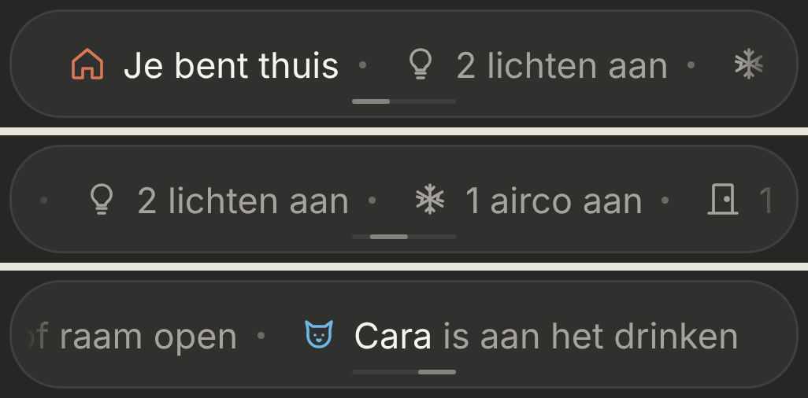

# Now ticker: the status band and "Nu"

The status line on Thuis becomes a band you swipe sideways: who's home, the travel time home, what's on, and what's happening right now ("Cara is aan het drinken"). Tapping it opens "Nu", the sheet that was "Wat staat aan". Dark mode only. Changes [whats-on](../whats-on/README.md) and [commute](../commute/README.md).

> ✅ **Approved (option B2, swiped with track D3) and built.** Don't change proportions or behaviour without asking first.
>
> Code: `StatusTicker` in `src/components/`, shown by `Header`; the items from `houseStatusItems()` in `src/lib/houseStatus.ts`; what's happening now in `NOW` in `src/config/status.ts`; the sheet in `WhatIsOnSheet`.

Source: [`options.html`](./options.html) (B1 and B2; B2 was chosen). The sheet:

As built (dev mode, mock data):

## The band

- **The status pill's place and shape** (46px, the same surface, border and corners), without the dot and the chevron. The band has the whole width.
- **You swipe it yourself.** It doesn't move on its own (an earlier version scrolled automatically; swiping makes it easier to get to what you want to see). The browser does the moving, including iOS's coasting and bouncing; it stops where you let go, without snapping to an item.
- **A small track at the bottom centre** (D3) shows there's more and how far you've swiped:
  - 44px wide, 2px high, 5px from the bottom of the pill; a 16px light piece moves from its left end (the start) to its right end (the end), in proportion to how far you've swiped;
  - it follows the coasting; while iOS bounces past an end, the piece stays on that end;
  - always the same brightness; not draggable or tappable (a tap opens "Nu", like anywhere on the pill);
  - **only when there's more than fits:** when everything fits, there's no track.
- **New items** keep the band where it is; if it gets shorter than where you are, it ends up at the new end. Back on Thuis it starts at the beginning.

The four ways to show it scrolls, and D1–D3: [`swipe-options.html`](./swipe-options.html) / [`swipe-options.png`](./swipe-options.png). Built (start, after a swipe, the end):

- **Items, in this order:**
  1. who's home, with an orange house: "Iedereen thuis", "Jeroen thuis", "Eline thuis", "Niemand thuis";
  2. the travel time home on Jeroen's office days, with a car: "34 min naar huis" (same conditions as [commute](../commute/README.md));
  3. lights, aircos, doors and windows, as the status line had them;
  4. what's happening now: "Cara is aan het drinken" with a cat in water blue (`#6cb8e6`), while `switch.0x94a081fffe562fad` (her water fountain) is on.
- **Nothing bold.** Who's home, the travel time and the names are white, the rest grey. A small dot between the items; soft edges left and right, with room so the first and last item end up clear of them.
- **Tapping it** opens "Nu". The Waze link is no longer in the band itself.

## "Nu"

- **The title is "Nu"** (was "Wat staat aan"). **No count** under it any more ("3 dingen aan").
- **"Naar huis"** on top when the travel time applies: a car tile, "34 min naar huis", "Route in Waze" and a **"Start route"** button. It opens `https://waze.com/ul?favorite=home&navigate=yes`, which starts the route to the "Home" favourite saved in Waze right away.
- **Then the sections as before:** "Lichten", "Airco's", each with only a switch. Nothing on: "Alles staat uit".

## Adding something that's happening now

A line in `NOW` (`src/config/status.ts`): the entity, an icon, a colour, the name (white) and the text (grey). It's in the band while the entity is `on`.
