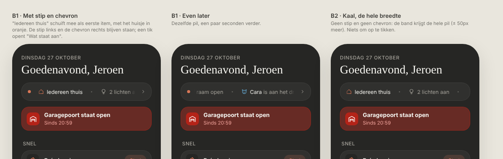
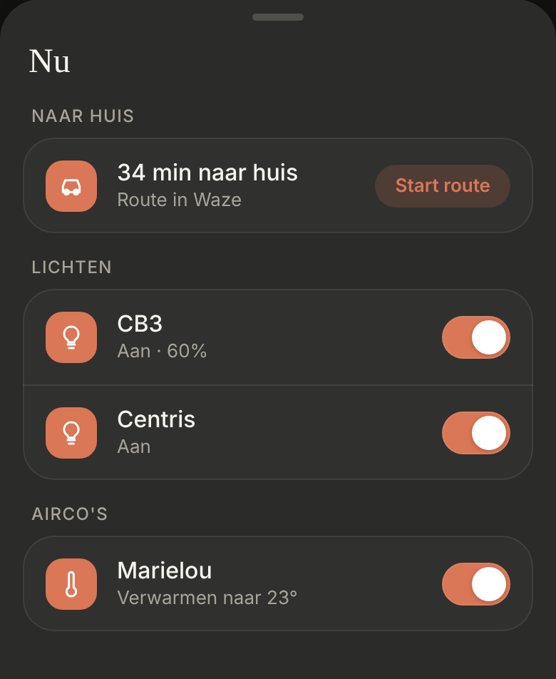
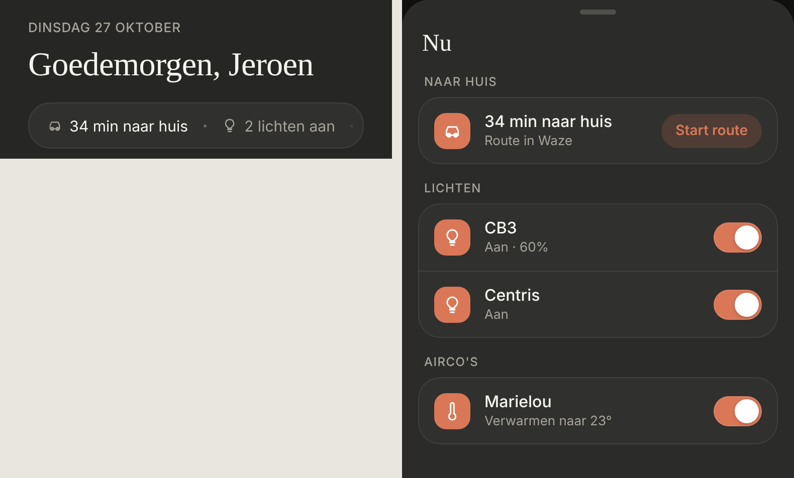

# Now ticker: the status band and "Nu"

The status line on Thuis becomes a band that scrolls by on its own, like a news ticker: who's home, the travel time home, what's on, and what's happening right now ("Cara is aan het drinken"). Tapping it opens "Nu", the sheet that was "Wat staat aan". Dark mode only. Changes [whats-on](../whats-on/README.md) and [commute](../commute/README.md).

> ✅ **Approved (option B2) and built.** Don't change proportions or behaviour without asking first.
>
> Code: `StatusTicker` in `src/components/`, shown by `Header`; the items from `houseStatusItems()` in `src/lib/houseStatus.ts`; what's happening now in `NOW` in `src/config/status.ts`; the sheet in `WhatIsOnSheet`.

Source: [`options.html`](./options.html) (B1 and B2; B2 was chosen). The sheet:

As built (dev mode, mock data):

## The band

- **The status pill's place and shape** (46px, the same surface, border and corners), without the dot and the chevron. The band has the whole width.
- **Everything scrolls,** also who's home, in a cycle. Nothing has to be tapped to be seen:
  1. it scrolls from the first item to the end, right to left, at 30px per second;
  2. at the end, with the last item fully in view, it rests for 3 seconds;
  3. it takes in what changed meanwhile (while it scrolls, the items stay as they were, so nothing changes under your eyes);
  4. it slides back to the start in 0.7 s (ease-in-out) and scrolls again.
- **When everything fits** in the width, there's nothing to scroll: the band stands still and changes right away.
- **Items, in this order:**
  1. who's home, with an orange house: "Iedereen thuis", "Jeroen thuis", "Eline thuis", "Niemand thuis";
  2. the travel time home on Jeroen's office days, with a car: "34 min naar huis" (same conditions as [commute](../commute/README.md));
  3. lights, aircos, doors and windows, as the status line had them;
  4. what's happening now: "Cara is aan het drinken" with a cat in water blue (`#6cb8e6`), while `switch.0x94a081fffe562fad` (her water fountain) is on.
- **Nothing bold.** Who's home, the travel time and the names are white, the rest grey. A small dot between the items; soft edges left and right, with room so the first and last item end up clear of them.
- **Tapping it** opens "Nu". The Waze link is no longer in the band itself.

## "Nu"

- **The title is "Nu"** (was "Wat staat aan"). **No count** under it any more ("3 dingen aan").
- **"Naar huis"** on top when the travel time applies: a car tile, "34 min naar huis", "Route in Waze" and a **"Start route"** button. It opens `https://waze.com/ul?favorite=home&navigate=yes`, which starts the route to the "Home" favourite saved in Waze right away.
- **Then the sections as before:** "Lichten", "Airco's", each with only a switch. Nothing on: "Alles staat uit".

## Adding something that's happening now

A line in `NOW` (`src/config/status.ts`): the entity, an icon, a colour, the name (white) and the text (grey). It's in the band while the entity is `on`.
