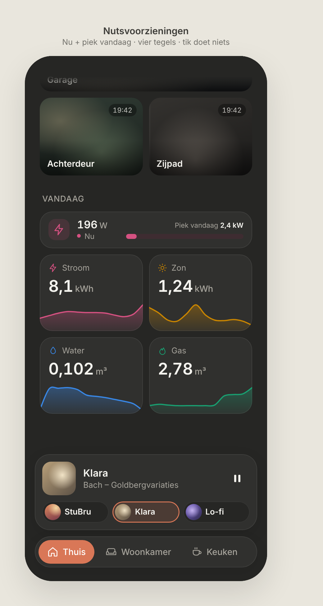

# Nutsvoorzieningen

Today's energy and water use on **Thuis**. Dark mode only. Replaces the owner's existing HA "Nutsvoorzieningen" section and follows the same design system as the [media card](../media-card/README.md) and [cameras](../cameras/README.md).

> ➡️ **Adjusted and built as [Verbruik](../verbruik/README.md).** What's below is the original approved design; Verbruik lists what changed.
>
> ✅ **Approved: final.** The owner approved this design. Build it exactly as designed, and don't change layout, colors, proportions or content without asking first.

Source: [`nutsvoorzieningen.html`](./nutsvoorzieningen.html) (a static mockup; open it in a browser, not part of the build).

---

## Placement

- A **"Vandaag"** section on Thuis, below **Camera's**. The page scrolls behind the docked mini media player.
- **Nothing is tappable.** There's no detail view and no tooltips. The section is read-only.

## Live card: "Nu" + "Piek vandaag"

- Full width, **fixed height of 59px**, the same as the original live card. **The height is a must** and must not grow.
- Left: an icon tile (34px, radius 11, Stroom color at 14% with the icon in Stroom color), the **current power** `196 W` (17px/600, unit 13px muted), and below it `● Nu` (12px muted, the dot in Stroom color).
- Right, filling the remaining width (18px gap):
  - **"Piek vandaag 2,4 kW"** on top, right-aligned (11px muted, value in text color/600).
  - Below it a **meter**: an 8px pill whose track is Stroom color at 14%, filled with Stroom color proportional to `current / today's peak`.
- The water flow (l/min) is **not shown**.

## Four tiles

A 2×2 grid with a 10px gap. **This order is fixed** (it's part of the color check, see below):

| | Left | Right |
|---|---|---|
| Top | **Stroom** · `bolt` icon · kWh | **Zon** (solar production) · `sun` icon · kWh |
| Bottom | **Water** · `drop` icon · m³ | **Gas** · `flame` icon · m³ |

Each tile has:
- A header: icon (15px, in the tile color) and name (13px, muted).
- **Today's value** (26px/600, tabular figures, **text color, not the tile color**) and its unit (14px, muted).
- A **sparkline of today**, full bleed at the bottom (46px high): a 2px line in the tile color, filled underneath with a vertical gradient from 38% to 6% of the tile color.
- **No "Gisteren"/yesterday line.**
- **Background and border are neutral:** the same as all other cards (`--surface`, `--border`), with no colored tint. The color lives only in the icon, the line and the fill.

## Colors

The dark steps from the dataviz reference palette, validated on surface `#30302e`:

| Utility | Color |
|---|---|
| Stroom | `#d55181` (magenta) |
| Zon | `#c98500` (yellow) |
| Water | `#3987e5` (blue) |
| Gas | `#199e70` (aqua green) |

- Validation (`validate_palette.js --mode dark --surface "#30302e"`) on the **grid-neighbour pairs** (Stroom–Zon, Zon–Gas, Gas–Water, Water–Stroom): **all checks pass.** The worst CVD ΔE is 8.4 and the worst normal-vision ΔE is 19.3.
- Pairs that would be hard to tell apart (magenta↔aqua) only meet **diagonally**, so **don't reorder the tiles.**
- Gas is aqua, not orange, because orange vs. Zon's yellow failed even for normal vision.

## Data (Home Assistant)

| UI | Source |
|---|---|
| Live power | Power sensor (W) |
| Piek vandaag | Max of the power sensor since midnight (statistics/recorder) |
| Tile values | Today's totals: electricity used, solar production, water, gas |
| Sparklines | Today's history of each sensor (recorder / `history/history_during_period`) |

The entity IDs are still to be provided.
