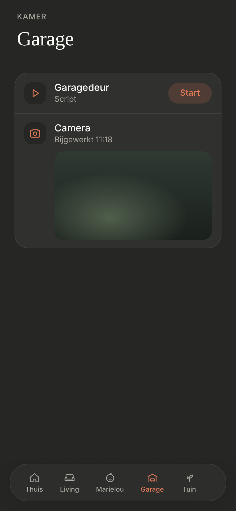
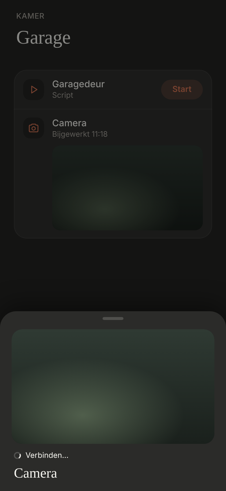

# Camera in a room

A camera as a control on a room page, with its still image under the name. Dark mode only. Builds on [cameras](../cameras/README.md): the same still image and the same live sheet.

> ✅ **Approved (option B) and built** (3 November). Don't change proportions or behaviour without asking first.
>
> Code: `CameraRow` in `src/components/cameras/CameraRow.tsx` (used by `EntityControl` for the `camera` domain), the shared `useStillImageRefresh` in `src/hooks/`, styles under `camera-row` in `src/styles.css`.

The options (A: a row with a thumbnail, B: a row with the picture under it, C: a large tile above the card) and the sheet: [`mockup.png`](./mockup.png) ([`mockup.html`](./mockup.html)). As built (dev mode, mock data), and after a tap:





## Config

One more entry in a room's `entities` (or a tab's), like any other control:

```ts
{ entity: Entity.GARAGE_DOOR_CAMERA, name: 'Camera' },
```

`name` and `icon` work as for any control; without `icon` it's the camera icon. The camera doesn't need to be in `src/config/cameras.ts`: Thuis and the rooms are configured separately.

## The row (B)

- **In the card**, like every other control: the icon tile, the name, and "Bijgewerkt HH:MM" (when the still image was last fetched).
- **The still image under it**, 16:9, radius 14, lined up with the name (like a cover's buttons). Refreshed every **10 s** while the room page is open and the sheet is closed, the same as the tiles on Thuis.
- **A tap anywhere on the row** opens the live sheet.
- A camera that's unavailable in HA is a plain row: "Niet beschikbaar", no image.

## The sheet

The live sheet from Thuis (`CameraSheet`), with only this camera: the live image, the status line and the name, no page dots. Streaming as on Thuis (WebRTC → HLS → MJPEG → still image); closing the sheet stops it.
