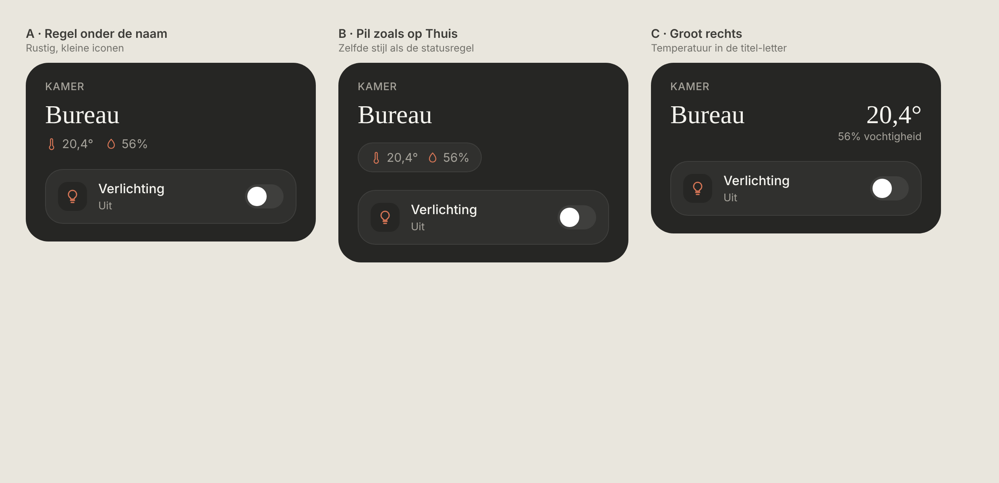
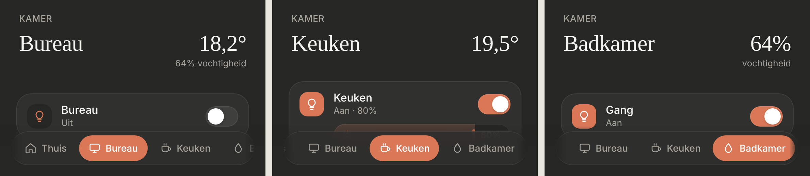

# Room header: temperature and humidity

A room page can show its temperature and humidity in the header, next to the room name. Dark mode only.

> ✅ **Approved (option C) and built.** Don't change proportions or behaviour without asking first.
>
> Code: `temperature` / `humidity` on a room in `src/config/rooms.ts`, `roomClimate` in `src/lib/rooms.ts`, the header in `RoomView.tsx`, styles under `room-header` in `src/styles.css`.



Source: [`mockup.html`](./mockup.html) (a static mockup; open it in a browser, not part of the build). The approved option is **C · Groot rechts**. As built (dev mode, mock data):



## Design (option C)

- **Temperature large, right of the name**, on the same baseline, in the same serif and size as the room name: "20,4°" (one decimal, Belgian notation).
- **Humidity below it**, small and muted, right-aligned: "56% vochtigheid".
- **Only humidity:** the humidity takes the large spot ("64%") with "vochtigheid" below.
- **Missing or unavailable sensor:** left out. With neither, the header is just "KAMER" + the name, as before.
- Display only: tapping does nothing.

## Config

Only these two fields, both optional, on the room:

```ts
{
  id: 'bureau', name: 'Bureau', icon: 'monitor',
  temperature: 'sensor.bureau_temperatuur',
  humidity: 'sensor.bureau_vochtigheid',
  entities: [ … ],
}
```

## Not chosen

- **A · Regel onder de naam:** a small line with icons under the name.
- **B · Pil zoals op Thuis:** the values in a pill like the Thuis status line.
