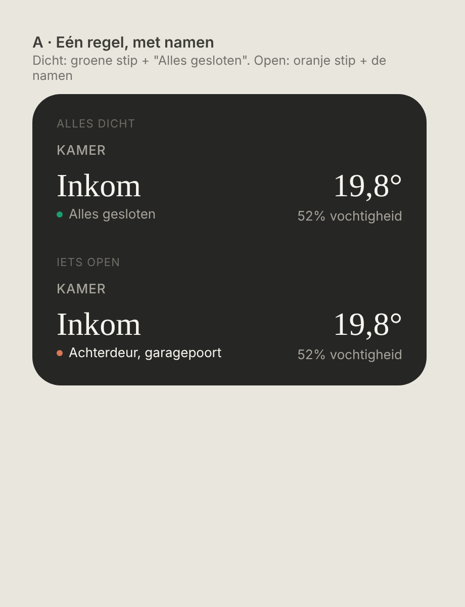
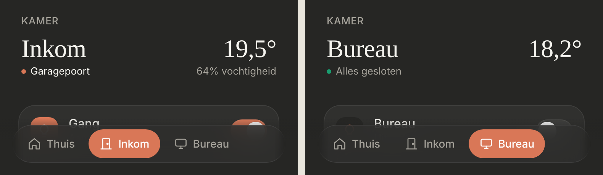

# Room openings: doors, windows and locks under the room name

One quiet line under the room name that says whether the room's doors, windows and locks are closed. Dark mode only. Sits next to the temperature from `docs/design/room-header`.

> ⛔ **Replaced by [`room-safety`](../room-safety/README.md).** `openings` became `safety`; the line now counts ("1 vraagt aandacht") and opens a sheet. Kept for history.



Source: [`mockup.html`](./mockup.html). As built (dev mode, mock data):



## Design

- **All closed:** a 6px **green** dot (`#199e70`) and "Alles gesloten" in muted 13px text.
- **Something open:** a 6px **red** dot (`#e5534b`, the red of a "middel" warning; *changed during the build from orange at the owner's request*) and the names of what's open, comma-separated, in regular text colour: "Achterdeur, garagepoort". No "open" after the names; the dot says it.
- Names come from `name` in the config, otherwise the entity's `friendly_name`. Only the first name keeps its capital.
- **Open** means `on`, `open`, `opening` or `unlocked` (the same as the status line on Thuis, plus unlocked locks).
- Missing or unavailable entities are left out. With none left, there is no line.
- **Display only:** no buttons, nothing to tap. To lock a door from the dashboard, also list the lock in the room's `entities`.

## Config

```ts
{
  id: 'inkom', name: 'Inkom', icon: 'door',
  temperature: 'sensor.inkom_temperatuur',
  openings: ['lock.voordeur', 'lock.achterdeur', { entity: 'sensor.garage_door_state_classification', name: 'Garagepoort' }],
  entities: [ … ],
}
```

## Not chosen

- **As a tab** with a row per door/window ([`options-tab.png`](./options-tab.png): orange icons, pills, tiles, split lists; [`options-tab-subtle.png`](./options-tab-subtle.png): quieter versions). Too prominent; the owner wanted it under the radar, as a room setting.
- **Under the name, other forms** ([`options.png`](./options.png)): B · only a count ("2 open"), C · a chip per item. A lock icon for "Alles gesloten" was replaced by the green dot.
