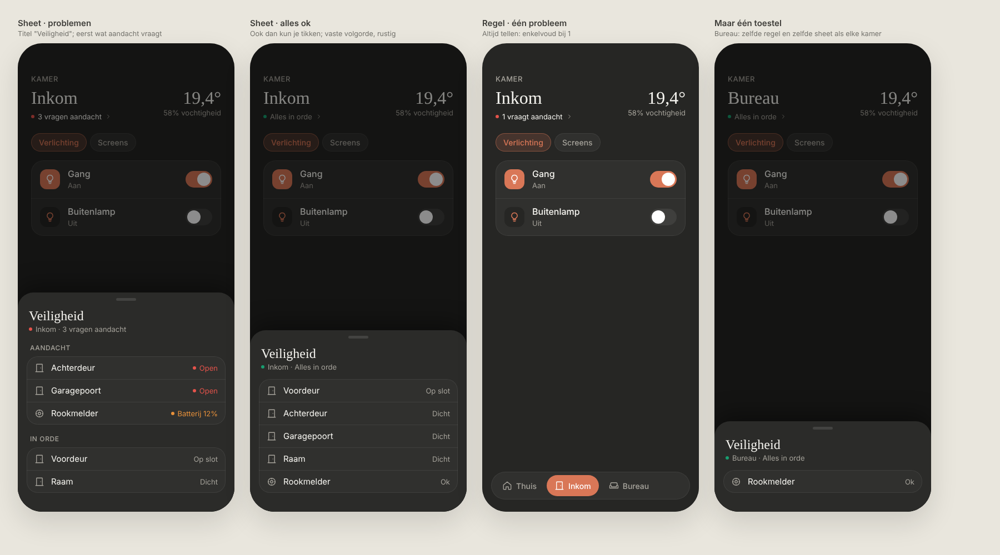
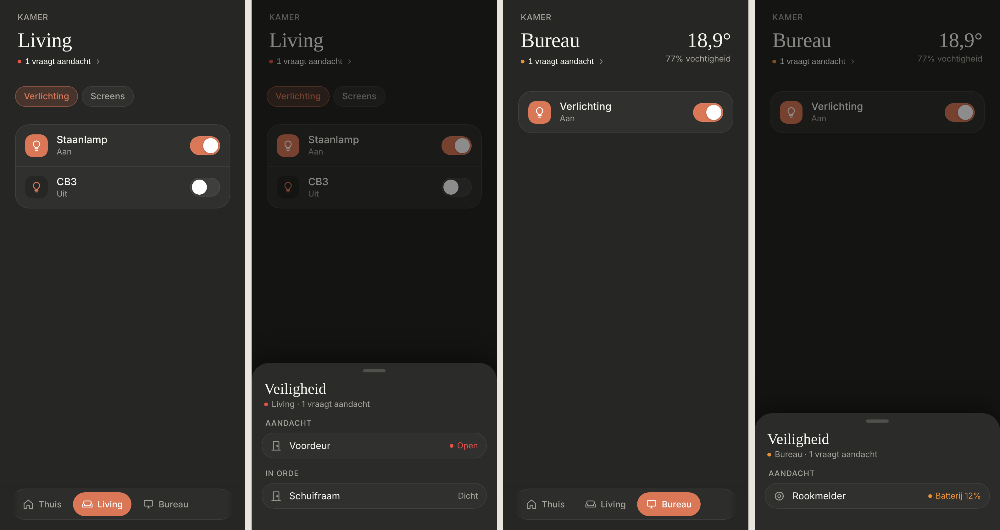

# Room safety: "Veiligheid" line and sheet

One quiet line under the room name that sums up the room's doors and smoke detectors; tapping it opens a "Veiligheid" sheet with one row per device. Dark mode only. Replaces `docs/design/room-openings`.

> ✅ **Approved and built.** Don't change proportions or behaviour without asking first.
>
> Code: `safety` on a room in `src/config/rooms.ts`, `roomSafety` in `src/lib/rooms.ts`, the line in `RoomView.tsx`, the sheet in `SafetySheet.tsx`, styles under `room-safety` / `safety-*` in `src/styles.css`.



Source: [`mockup.html`](./mockup.html). As built (dev mode, mock data):



## Line under the room name

- Always a count, never a device name: **"Alles in orde"**, **"1 vraagt aandacht"**, **"3 vragen aandacht"**, followed by a small "›".
- A 6px dot in the worst colour: red (`#e5534b`) if anything is red, orange (`#e8913a`) if only orange, otherwise green (`#199e70`). Text is muted when all is fine, regular text colour otherwise.
- The same line for every room, also with only one device. Tapping it opens the sheet (selection haptic).

## Sheet

- Slides up from the bottom over a dimmed page. Title "Veiligheid", subtitle "• <Room> · <summary>".
- With problems: an **AANDACHT** group first (red before orange), then **IN ORDE** (left out when empty). All fine: one list in config order.
- Each row: icon, name, state on the right. No subtitles or explanations. Problem states get their colour and a dot.
- Close by swiping the handle down or tapping beside the sheet. Display only: nothing in the sheet is tappable.

## Devices

Told apart by the entity's `device_class` (Developer tools → States). Other device classes, missing and unavailable entities are left out; with none left, there is no line.

| `device_class` | In orde | Aandacht |
|---|---|---|
| `door` | Dicht | Open (red) |
| `smoke` | Ok | Rook (red) |
| `smoke` + `battery` under 15% | | Batterij 14% (orange) |
| `smoke` + `battery` under 10% | | Batterij 9% (red) |

Smoke beats the battery. `battery` is optional: a sensor with the percentage.

## Config

```ts
safety: [
  { entity: 'binary_sensor.0x001788011004451e_contact', name: 'Voordeur' },
  { entity: 'binary_sensor.0x0015bc003106406b_smoke', name: 'Rookmelder', battery: 'sensor.0x0015bc003106406b_battery' }
],
```

## Not chosen

- Naming the device in the line ("Achterdeur open"): always count instead.
- Grouping doors and windows into one row: a room usually has only 1–2.
- Subtitles in rows ("Open sinds 14:02", "Vervang de batterij", "Batterij 100%").
- Locks and windows: left out for now.
