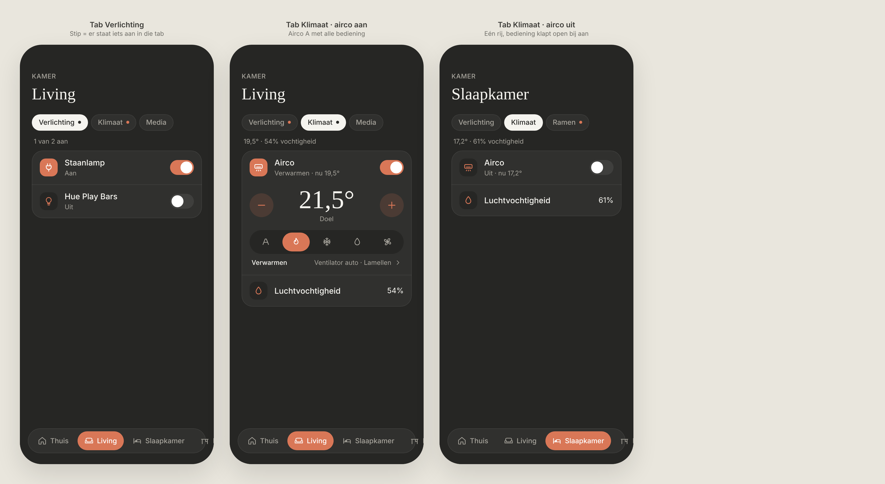

# Room tabs + airco (MELCloud)

Room pages split into tabs, and the airco control for MELCloud units in the "Klimaat" tab. Dark mode only, current colours (orange accent; the "colour per device type" experiment is on hold).

> ✅ **Approved (tabs + airco option A).** **Tabs: built.** **Airco: not built yet** (climate entities still use the plain − / + row). The owner chose this design. Don't change proportions or behaviour without asking first.
>
> Tabs code: `sections` in `src/config/rooms.ts`, `resolveRooms` / `sectionSummary` / `sectionIsActive` in `src/lib/rooms.ts`, `RoomView.tsx`, styles under `room-tab` in `src/styles.css`.
>
> *Decision during the build:* a section can mix entity types, so the summary line combines what applies (e.g. "1 van 2 aan · 19,5°"), and media adds "Speelt".



Source: [`mockup.html`](./mockup.html) (a static mockup; open it in a browser, not part of the build).

## Tabs

- **Under the room title:** a row of chips, one per section, in the order of the config (e.g. Verlichting, Klimaat, Media). The active chip is light (`--text` background, `--bg` text). The others are `--surface` with a thin border. The row scrolls horizontally if it doesn't fit.
- **Only the active tab's controls are visible**, in one card (the current row group).
- **Dot on a chip:** a 6px accent dot when something in that tab is on (a light, a switch, the airco, a cover that's open, a media player that's playing). On the active chip, the dot is dark.
- **Summary line** (13px, muted) between the chips and the card, for the active tab only:
  - lights and switches: "1 van 2 aan" or "Alles uit";
  - climate: "19,5° · 54% vochtigheid" (from the room's temperature and humidity);
  - covers and windows: "1 open" or "Alles dicht".
- **Starting tab:** a room always opens on its first tab. Nothing is remembered between visits.
- **One section only:** no chips, just the card (as today).
- Switching tabs is instant. The dock is fixed, so a shorter tab doesn't make anything jump.

### Config

```ts
{
  id: 'living', name: 'Living', icon: 'sofa',
  sections: [
    { title: 'Verlichting', entities: ['switch.0x94a081fffe4fce2f', 'light.huecupboard'] },
    { title: 'Klimaat', entities: ['climate.airco_living', 'sensor.airco_living_humidity'] },
    { title: 'Media', entities: ['media_player.living_room'] },
  ],
}
```

A room with a plain `entities` list keeps working as one section without tabs. Missing entities are skipped as today, and an empty section is hidden.

## Airco (option A)

A `climate` entity from MELCloud becomes a row ("Airco", "Verwarmen · nu 19,5°", switch). The icon tile and the switch use the accent while it's on.

**While on**, the controls open below the row:

| Part | Spec |
|---|---|
| Target temperature | Serif, 52px, centred, "Doel" below it (13px, muted) |
| − / + | 48px round buttons, accent tint background, accent icon. 0.5° per tap (`target_temp_step`), clamped to `min_temp` / `max_temp`. Sent debounced, like the brightness slider. |
| Mode bar | Pill on `--bg` with five icon buttons (38px high): Auto, Verwarmen, Koelen, Drogen, Ventileren. The active one is filled. Modes the unit doesn't list in `hvac_modes` are hidden. |
| Bottom line | Left: the active mode's name. Right: "Ventilator auto · Lamellen ›", which opens the sheet. |

**While off:** only the row, with "Uit · nu 17,2°". Turning the switch on calls `climate.turn_on` and opens the controls. Picking a mode also turns the unit on.

### Sheet: fan and vanes

Opened from "Ventilator · Lamellen ›" (the third screen in [`airco-options.png`](./airco-options.png)). It uses the same sheet and handle pattern as the expanded player.

- **Ventilator:** a segmented control: Auto, then 1–5 shown as signal bars (`fan_modes`, `climate.set_fan_mode`).
- **Lamellen:** Auto, five angle icons, Swing (`swing_modes`, `climate.set_swing_mode`).
- **Tiles:** today's energy use and the outside temperature, only if MELCloud provides those sensors.

### Home Assistant mapping

| UI | HA |
|---|---|
| Switch | `climate.turn_on` / `climate.turn_off` |
| Second line | `hvac_action`/`state` → "Verwarmen", "Koelen", "Drogen", "Ventileren", "Auto"; `current_temperature` → "nu 19,5°" |
| − / + | `climate.set_temperature` with `temperature` |
| Mode bar | `climate.set_hvac_mode`; the buttons come from `hvac_modes` (`heat_cool`/`auto` → Auto, `fan_only` → Ventileren) |
| Fan / vanes | `climate.set_fan_mode` / `climate.set_swing_mode` |

## Not chosen

- **Sections stacked under each other** (all sections visible, each with a heading and a summary): the owner preferred the tabs.
- **Airco option B · dial** (an arc with the target and the current temperature): see [`airco-options.png`](./airco-options.png). Option A was preferred.
- **An "Airco" section on Thuis** with a tile per unit, also in `airco-options.png`: not decided, so not part of this design.
- **A colour per device type** (yellow lights, blue water, …): on hold. It may come back as a separate design.
