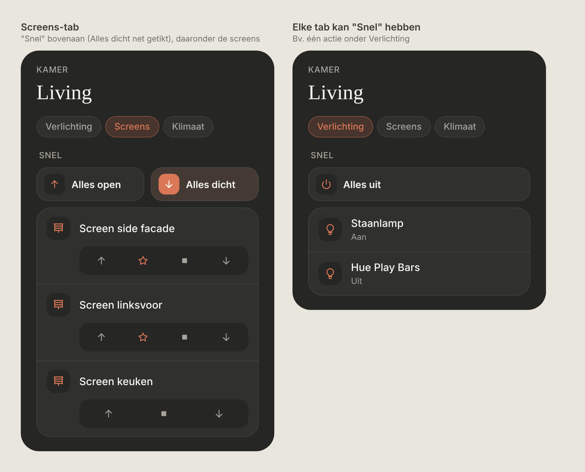
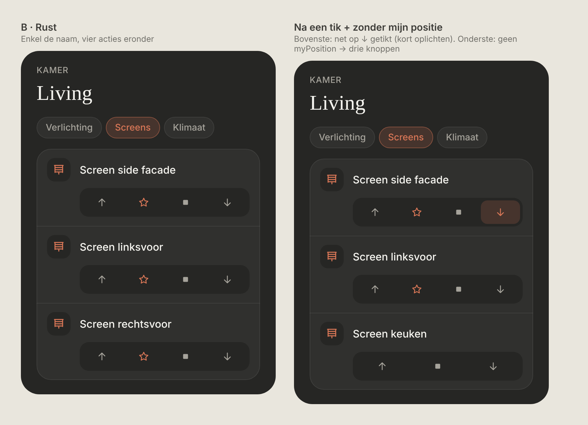
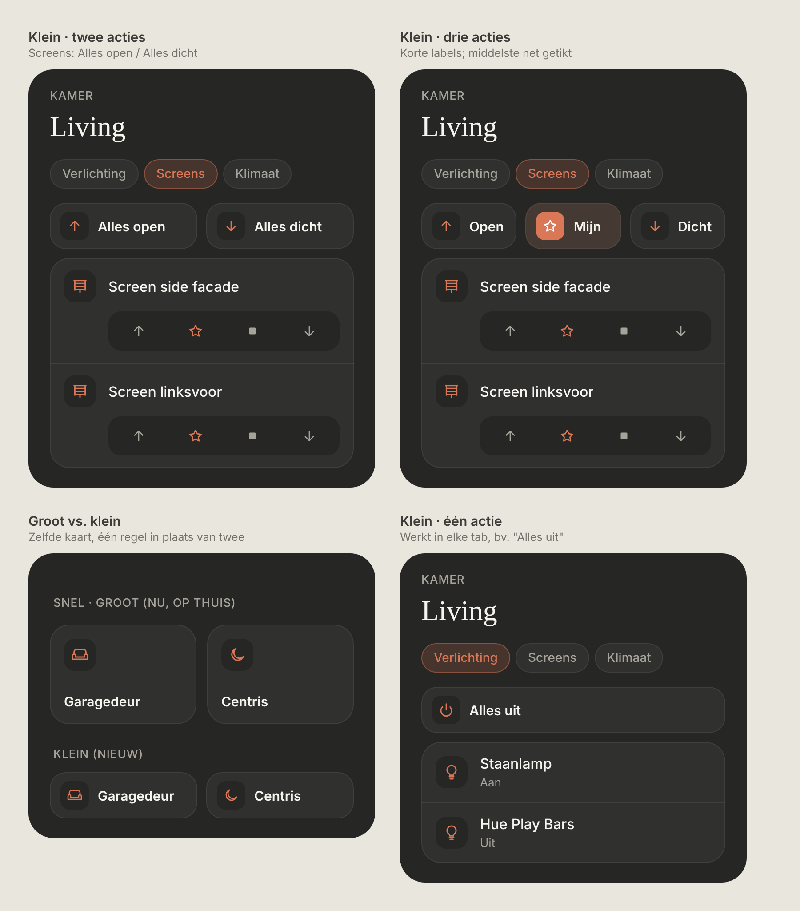

# Screens (RTS covers) + "Snel" in room tabs

Controls for RTS screens on a room page, and a small "Snel" row of shortcuts at the top of any tab (e.g. "Alles open" / "Alles dicht"). Dark mode only. Builds on the room tabs (`docs/design/room-tabs-airco`).

> ✅ **Approved and built.** The owner chose this design. Don't change proportions or behaviour without asking first.
>
> Code: `QuickCard.tsx` (large + small Snel card), `CoverButton` / cover row in `RoomView.tsx`, `rowModel` (kind `cover`) and `resolveRooms` in `src/lib/rooms.ts`, styles `quick-card--small`, `quick-row`, `cover-strip`.
>
> *Decisions during the build:* every `cover.*` gets the strip (not only screens); each button only shows if the cover's `supported_features` allows it (up 1, down 2, stop 8; all three when the attribute is missing). A cover with a known state keeps its second line ("Open · 40%" / "Dicht"); an `unknown` one shows only the name.



Source: [`mockup.html`](./mockup.html) (a static mockup; open it in a browser, not part of the build).

## Screen control (option B)

RTS screens never report their position: HA keeps them `unknown`. So a screen gets **buttons, not a switch**.



- **Row:** icon tile (blinds) + the name only. **No second line**: no state, no "last action", no time.
- **Strip under the row** (indented under the name, `--bg` background, radius 14, 4px padding, buttons 36px high, equal width):
  **↑ omhoog · ★ mijn positie · ■ stop · ↓ omlaag**
  - ↑ / ■ / ↓: `cover.open_cover` / `cover.stop_cover` / `cover.close_cover` on the screen.
  - ★: `button.press` on the linked "My position" button entity. The ★ icon is accent-coloured, the others muted.
  - Without a `myPosition` entity: three buttons (↑ ■ ↓) spread over the full strip.
- **Tap feedback:** the tapped button lights up briefly (accent tint background, accent icon), then returns to normal. Nothing stays selected, because HA doesn't know the real position.
- Works for screens that are `cover.*`. They don't need `allowUnknownState`: the strip doesn't depend on the state.

## "Snel" in a tab



- A tab can have shortcuts. They show at the top of the tab under a **SNEL** heading (same style as "Snel" on Thuis), above the tab's card.
- **Small variant of the Thuis "Snel" card** (same component, `size="small"`): icon tile and label on **one line**.

| | Large (Thuis) | Small (tabs) |
|---|---|---|
| Layout | Icon on top, label below | Icon and label side by side |
| Height | 112px | 52px |
| Radius | 22px | 18px |
| Icon tile | 36px | 32px |

- As many cards per row as there are shortcuts (1, 2 or 3); labels are cut off with "…". With three, keep labels to about 6 characters.
- Same behaviour as on Thuis: calls `<domain>.<service>` (default `turn_on`), highlighted while the entity is `on`, "Dat lukte niet" only on error. Plus a brief light-up on tap, like the screen buttons.
- A tab without shortcuts shows no "Snel".

## Haptic feedback (all controls)

Every control in this design gives haptic feedback via the HA Companion app (`haptic()` in `src/lib/haptic.ts`):

| Control | On tap | On error |
|---|---|---|
| Screen buttons (↑ ★ ■ ↓) | `light` | `failure` |
| Snel cards (small and large) | `light` | `failure` |
| Tabs | `selection` (already built) | n/a |

## Config

```ts
{
  title: 'Screens',
  shortcuts: [
    { label: 'Alles open', icon: 'up', entity: 'script.screens_open' },
    { label: 'Alles dicht', icon: 'down', entity: 'script.screens_close' },
  ],
  entities: [
    { entity: 'cover.screen_side_facade', name: 'Screen side facade', myPosition: 'button.screen_side_facade_my_position' },
    { entity: 'cover.screen_keuken' },
  ],
}
```

- `shortcuts` per section uses exactly the same fields as `src/config/shortcuts.ts` (`label`, `icon`, `entity`, `service?`, `detail?`).
- `myPosition` on a room entity: the "My position" button entity for that screen.
- New icons needed: `up`, `down`, `stop`, `star` (same line style as the others).

## Not chosen

- **Screen control** ([`options-screen.png`](./options-screen.png)): A · round ↑ ★ ↓ in the row (names wrapped), C · only ↑ ↓ with "my position" on a long press (invisible), D · A plus an "Alle screens" row.
- **Where the "all screens" actions go** ([`options-all.png`](./options-all.png)): a row "Alle screens" in the card, or two pills above the card. Replaced by the small Snel cards.
- A second line on the screen row ("Laatst omlaag · 13:02"): dropped; the row shows only the name.
