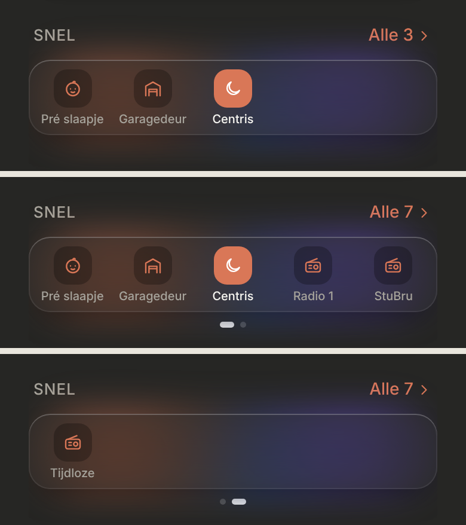
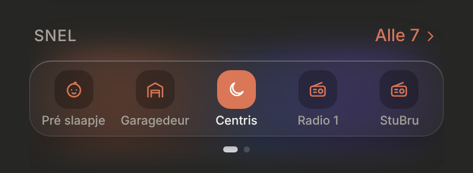

# Snel as a glass dock (D2)

"Snel" on Thuis: the shortcuts as small icons in one glass card, five per page, with every shortcut in a sheet behind "Alle". Dark mode only. Replaces the list in [`snel-list`](../snel-list/README.md) on Thuis; that list lives on in the sheet.

> ✅ **Approved (D2) and built** (28 October). Don't change proportions or behaviour without asking first.
>
> Code: `src/components/QuickActions.tsx`, config in `src/config/shortcuts.ts`, styles under "Snel (docs/design/snel-dock, D2)" in `src/styles.css`.

The mockup: [`mockup.png`](./mockup.png) ([`mockup.html`](./mockup.html)). The options before it (C4, D1–D3): [`options.png`](./options.png) ([`options.html`](./options.html)).

As built (dev mode, mock data), with three shortcuts, the sheet, and with seven (two pages):






## Config

`src/config/shortcuts.ts`. As many shortcuts as you like, each configured exactly like a control in a room (`RoomEntity`), plus `onThuis`:

```ts
{ entity: Entity.CENTRIS_LIGHT, name: 'Centris', icon: 'moon', onThuis: true },
```

- **`onThuis: true`:** in the dock on Thuis, in config order.
- **Without it:** only in the sheet behind "Alle".
- At most **10** fit on Thuis (two pages of five). More than that: the first 10, and a warning in the console.

## On Thuis

- **The heading:** "SNEL" on the left, **"Alle N ›"** on the right in the accent colour, N being the number of all shortcuts. Opens the sheet.
- **The dock:** one glass card (radius 18) over soft colour blobs, with five shortcuts per page side by side: a 32px icon tile (radius 11) and the name under it (10px, cut off with "…" when too long).
- **Swiping** moves exactly one page of five at once, and both pages slide as one belt in the same card, not as two separate cards. Swipe left for the second page. **Page dots** under the card only with more than one page.
- **A tap** does the control's main thing: start a scene or script (spinner, then a check), switch a light or switch (the icon tile turns accent while on). Anything else (a cover, an airco) opens the sheet, where its full control is. On an error the name reads "Mislukt".
- **No shortcuts with `onThuis`:** only the heading with "Alle". **No shortcuts at all:** no section.

## The sheet

The shared `BottomSheet`, titled "Snel" (serif, 24px), with every shortcut as the slim control from [`snel-list`](../snel-list/README.md), in config order.

## Open

- **The glass blur:** in the dashboard, `backdrop-filter` doesn't blur the page behind the card (in an isolated test, also inside a shadow DOM, it does). The card looks right because of its own colour blobs, but the cause isn't found yet. Glass for the navigation dock and the mini player waits on this.
