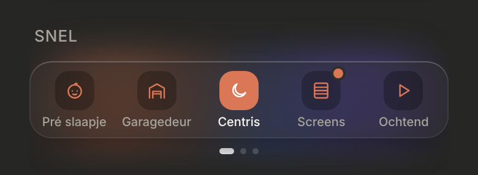
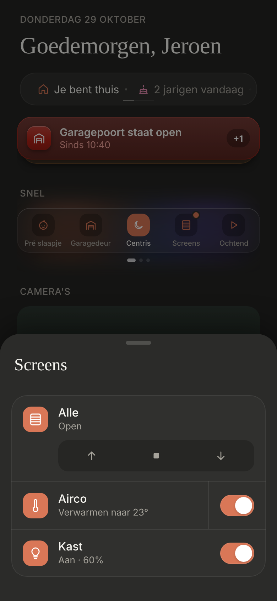

# Snel as a glass dock (D2)

"Snel" on Thuis: every shortcut as a small icon in one glass card, five per page. A shortcut either triggers its entity, or opens a sheet with several entities. Dark mode only. Replaces the list in [`snel-list`](../snel-list/README.md); its controls live on in the sheets.

> ✅ **Approved (D2) and built** (28 October). **Sheet shortcuts approved and built** (29 October); the "Alle" sheet and `onThuis` are gone. Don't change proportions or behaviour without asking first.
>
> Code: `src/components/QuickActions.tsx`, config in `src/config/shortcuts.ts`, styles under "Snel (docs/design/snel-dock, D2)" in `src/styles.css`.

The dock's mockup: [`mockup.png`](./mockup.png) ([`mockup.html`](./mockup.html)), the options before it (C4, D1–D3): [`options.png`](./options.png) ([`options.html`](./options.html)). The sheet shortcut's mockup: [`sheet-mockup.png`](./sheet-mockup.png) ([`sheet-mockup.html`](./sheet-mockup.html)).

As built (dev mode, a test config with 13 shortcuts), the dock and a sheet shortcut's sheet:





## Config

`src/config/shortcuts.ts`, as many shortcuts as you like, in display order. Two kinds:

```ts
// An entity, configured exactly like a control in a room (RoomEntity).
{ entity: Entity.CENTRIS_LIGHT, name: 'Centris', icon: 'moon' },

// A sheet: its name and icon on the tile, its entities in the sheet.
{
  name: 'Screens',
  icon: 'blinds',
  sheet: [
    { entity: Entity.LIVING_SCREENS_ALL, name: 'Alle' },
    { entity: Entity.LIVING_SCREEN_LEFT_FRONT, name: 'Linksvoor', myPosition: Entity.LIVING_SCREEN_LEFT_FRONT_MY_POSITION },
  ],
},
```

- **An entity shortcut** is for what a tap can do by itself: a scene or script (start), a light or switch (on/off). A cover, an airco and the like go in a sheet, even on their own; as an entity shortcut, a tap on them does nothing.
- **A sheet's entries** are configured exactly like a room's, so `myPosition`, `members` and so on work there too. The sheet's title is the shortcut's `name`, so the group's own entry gets its own name, e.g. "Alle".
- Entities missing in HA are left out; a sheet with none of its entities in HA is left out entirely; with no shortcuts left, there is no section.

## On Thuis

- **The heading:** "SNEL", nothing else.
- **The dock:** one glass card (radius 18) over soft colour blobs, five shortcuts per page side by side: a 32px icon tile (radius 11) and the name under it (10px, cut off with "…" when too long). No limit on the number of pages.
- **Swiping** moves exactly one page of five at once, and the pages slide as one belt in the same card. Swipe left for the next page. **Page dots** under the card only with more than one page; no counter.
- **An entity shortcut:** a tap starts a scene or script (spinner, then a check) or switches a light or switch (the icon tile turns accent while on). On an error the name reads "Mislukt".
- **A sheet shortcut:** a thin orange ring (1px, the accent colour) around the icon tile. No on/off state. A tap opens its sheet.

## The sheet

The shared `BottomSheet`, titled with the shortcut's name (serif, 24px), with its entities as the same controls as in a room (not the slim ones), in config order. A long list scrolls inside the sheet (at most 85% of the screen high).

## Open

- **The glass blur:** in the dashboard, `backdrop-filter` doesn't blur the page behind the card (in an isolated test, also inside a shadow DOM, it does). The card looks right because of its own colour blobs, but the cause isn't found yet. Glass for the navigation dock and the mini player waits on this.
