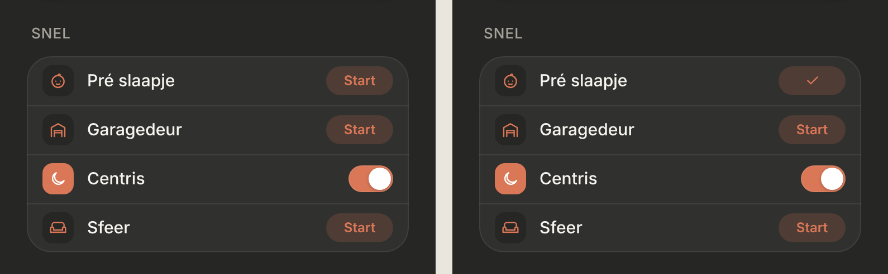

# Snel as a list, with slim controls

"Snel" on Thuis becomes one list of controls (option C), in the slim variant (S1). Dark mode only.

> ↪ **On Thuis replaced by the [glass dock](../snel-dock/README.md)** (28 October). Its controls live on in the sheets of sheet shortcuts; the slim look (S1) was removed along with the "Alle" sheet.
>
> ✅ **Approved (C + slim S1) and built.** Don't change proportions or behaviour without asking first.
>
> Code: `EntityControl` in `src/components/EntityControl.tsx` (extracted from `RoomView.tsx`, shared by the rooms and Snel), `QuickActions.tsx`, styles under "slim controls" in `src/styles.css`.

Options for Snel: [`options.png`](./options.png) ([`options.html`](./options.html)). The slim variants: [`slim.png`](./slim.png) ([`slim.html`](./slim.html)). As built (dev mode, mock data), and right after tapping "Start":

## The list (C)

- **One card, one row per shortcut,** in the order of `src/config/shortcuts.ts`. No grouping; a new shortcut is simply a new row.
- **Each row is the same control as in a room** (`EntityControl`): the domain decides what a tap does. "Start" for a scene or script, a switch for a light or switch, and so on. The feedback is the same too: the checkmark in "Start" after a tap, "Dat lukte niet" on an error.
- **Only an icon, a name and the control.** No second line, except "Dat lukte niet".
- **Configured exactly like a control in a room** (`RoomEntity`: `entity`, `name`, `icon`, `members`, `myPosition`, `simple`, `allowUnknownState`) and resolved the same way (`resolveRows`). So a light with `members` opens its light sheet from Snel too. The config itself is separate from the rooms: nothing is shared or looked up. A shortcut whose entity doesn't exist in HA is left out, as in a room.
- **`icon`** replaces the icon that goes with the domain; it's now optional for room controls too.

## Slim (S1)

The room controls, smaller; pure CSS (`row-group--slim`), the same markup:

| | Room | Slim |
|---|---|---|
| Row | 60px, padding 12px 16px, gap 14px | 44px, padding 8px 14px, gap 12px |
| Icon tile | 36px, radius 12, icon 20px | 28px, radius 9, icon 16px |
| Name | 16px | 15px |
| "Start" | 32px high | 26px high, 12px text |
| Switch | 48 × 30 | 40 × 24 |

## Not chosen

- **For Snel:** A · compact cards in two columns, B · round buttons like the iOS Control Center, D · pills. The old large tiles are gone; the small cards stay for Snel in the room tabs.
- **For slim:** S2 · a bare icon with "Start" as text, S3 · like iOS Settings.
