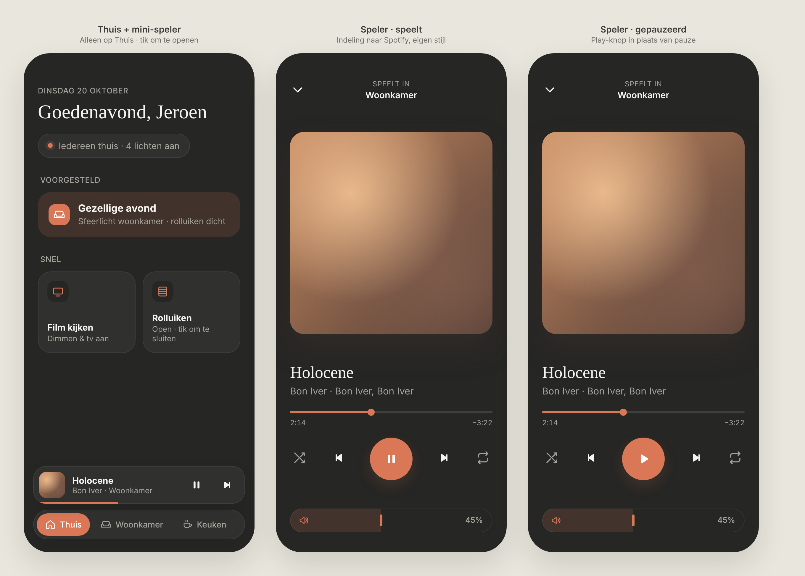

# Sonos player: design (approved, not built yet)

`mockup.html` is the static source of the image above. Open it in a browser to view or tweak it; it is not part of the build.

## Scope

Two parts, deliberately small:

1. **Mini player**: only on **Thuis**, docked just above the bottom navigation. Room pages never show it.
2. **Full player**: a sheet that opens when you tap the mini player and closes with the ⌄ button or a swipe down.

**Out of scope, by choice:** speaker grouping, per-speaker volume, Sonos favorites, a source picker, queue, lyrics, share.

## Mini player

- Album art (44px, rounded 12px), title, and `artist · speaker name` on one line, truncated with an ellipsis.
- Play/pause and next buttons on the right.
- A thin progress line (3px, accent color) along the bottom edge of the card.
- Only shown while there's a track loaded (playing or paused); hidden when idle or off.

## Full player

The layout follows Spotify's player; the styling is our own design system.

From top to bottom:

| Element | Details |
|---|---|
| Top bar | ⌄ (close) on the left. Centred: small uppercase label "Speelt in" with the speaker name below it. |
| Album art | Nearly full width (screen width minus 24px gutters), square, radius 24px, soft shadow. Flexible space above and below. |
| Title | Serif (`--font-serif`), ~28px, left-aligned. |
| Artist | `artist · album`, muted, 16px, left-aligned. |
| Progress | Thin 4px bar with an accent fill and round knob; elapsed time on the left, remaining (`−3:22`) on the right. |
| Controls | Shuffle · previous · **play/pause** · next · repeat. Play/pause is a 72px accent circle. Shuffle and repeat are muted when off, accent when on. |
| Volume | The **pill slider** (same component as the light brightness slider), as the last element at the bottom with clear space above it. |

The progress, controls and volume form one block at the bottom, within thumb reach. The art takes the flexible space at the top, so the screen is filled without empty gaps.

## Style

- **Dark mode only.** Palette: `--bg #262624`, `--surface #30302e`, `--text #f5f4ef`, `--muted #a6a39b`, `--accent #d97757`.
- One accent color: only the progress fill, the play button, the volume fill and active shuffle/repeat use it.
- Same radii, spacing and type scale as the rest of the dashboard.

## Home Assistant mapping (`media_player.*` from the Sonos integration)

| UI | HA |
|---|---|
| Title / artist / album | `media_title`, `media_artist`, `media_album_name` |
| Album art | `entity_picture` (relative URL served by HA; prefix with the HA URL in dev) |
| Progress | `media_position`, `media_duration`, `media_position_updated_at` (extrapolate while playing) |
| Play/pause, prev, next | `media_player.media_play_pause`, `media_previous_track`, `media_next_track` |
| Shuffle / repeat | `shuffle`, `repeat` attributes; `media_player.shuffle_set`, `media_player.repeat_set` |
| Volume | `volume_level` (0–1); `media_player.volume_set`, debounced like the brightness slider |
| Speaker name | entity `friendly_name` |

## Decisions

- **One speaker group** for now: the player follows a single `media_player` entity, to be configured when the player is built (entity ID still to be added).
- **Dark mode only** applies to the whole dashboard, not just this player.
