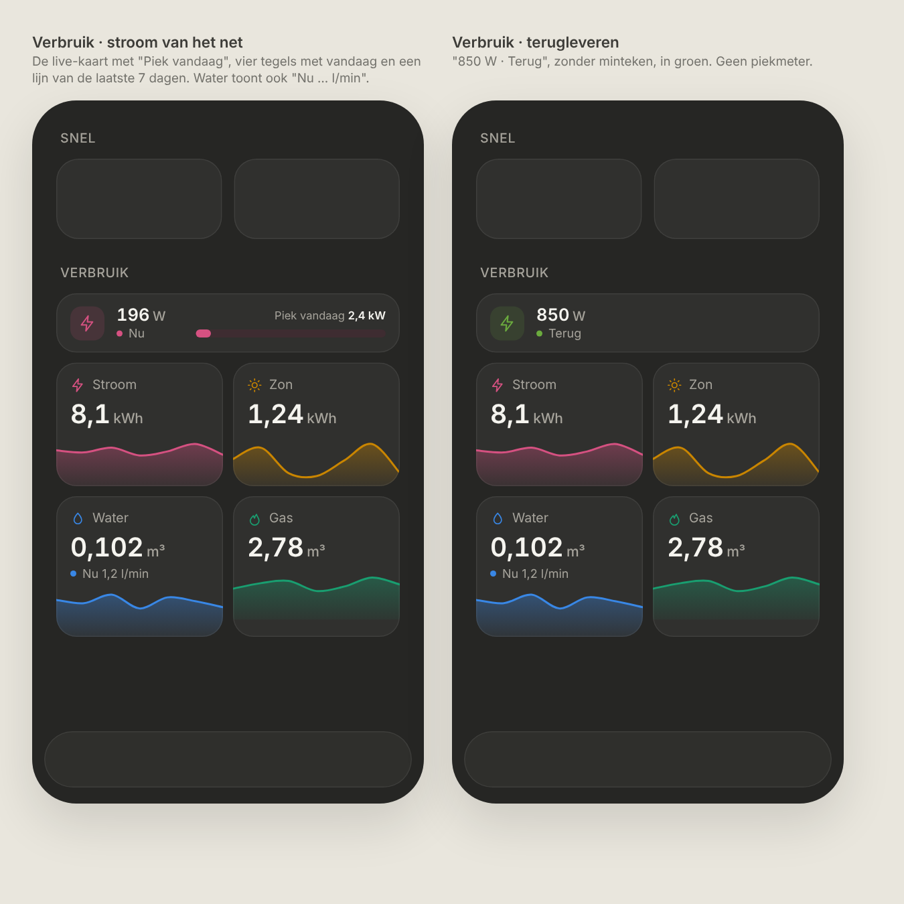
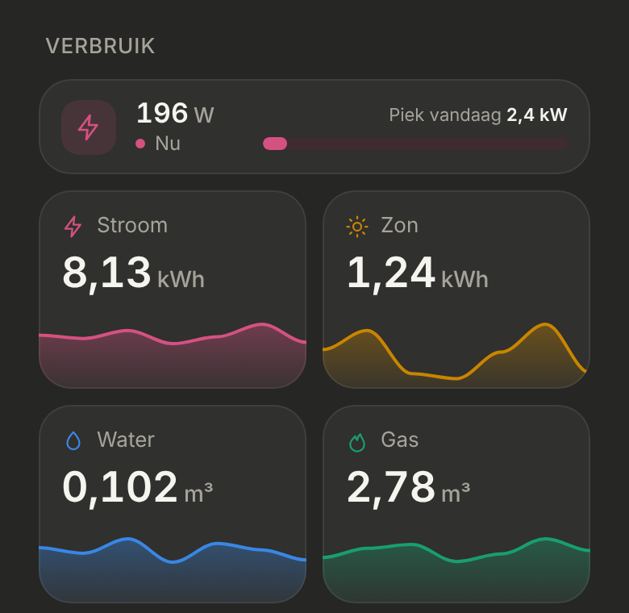

# Verbruik: energy and water on Thuis

The approved [Nutsvoorzieningen](../nutsvoorzieningen/README.md) design, adjusted to the owner's current HA section. Dark mode only. Read-only: nothing is tappable.

> ✅ **Approved.** Don't change layout, colours, proportions or content without asking first.
>
> Code: the sections in `src/config/statistics.ts`, `StatisticsSection` in `src/components/StatisticsSection.tsx`, the HA statistics in `src/lib/statistics.ts`.

Source: [`mockup.html`](./mockup.html). The options for the water flow: [`options.png`](./options.png). As built (dev mode, mock data):

## What changed compared to Nutsvoorzieningen

- **Title "Verbruik"** (was "Vandaag"), **below Snel**. Camera's isn't on master yet; when it is, it goes between them.
- **Sparklines: the last 7 days, one point per day**, today last (was: today's history).
- **No water flow.** It was approved as a line "Nu 1,2 l/min" in the water tile (W3), then removed during the build at the owner's request: the flow sensor isn't connected. The mockup still shows the line.
- **Feeding back** (the power sensor is negative): "850 W · Terug", **without a minus sign**, with the icon and dot in green (`#6bab3e`, not the Gas tile's aqua). The peak meter is hidden.
- **A reusable section:** any number of sections, each with an optional live card and its own tiles. **Each tile's colour is set in the config**; the four approved colours are the defaults in the owner's config. Validated as a palette only in this order (Stroom, Zon / Water, Gas).
- **Charts with ApexCharts** (`apexcharts/core` + `apexcharts/area`, pinned), at the owner's request.

## Everything else, as approved

- **Live card**, a fixed 59px high: icon tile, the current power ("196 W", "● Nu"), and on the right "Piek vandaag 2,4 kW" with an 8px meter (current / today's peak).
- **Tiles** in a 2×2 grid: icon and name, today's value (26px, text colour), unit, the sparkline full bleed at the bottom (46px, 2px line, gradient from 38% to 6%). Neutral background and border; the colour only in the icon, the line and the fill. Tiles in a row are equally high; the sparkline sits at the bottom.

## Data (Home Assistant)

| UI | Source |
|---|---|
| Live power | The power sensor's state (W); negative = feeding back |
| Piek vandaag | `recorder/statistic_during_period`, max of the power sensor since midnight |
| Tile value | The daily sensor's state (it resets at midnight) |
| Sparkline | `recorder/statistics_during_period`, period day, `change`: the 6 days before today, plus today's state |
