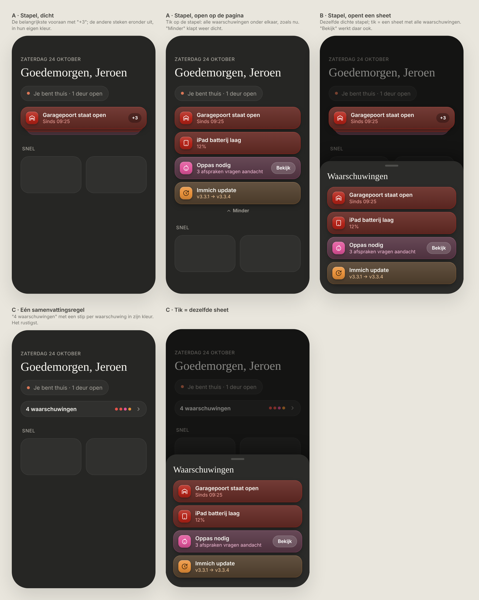
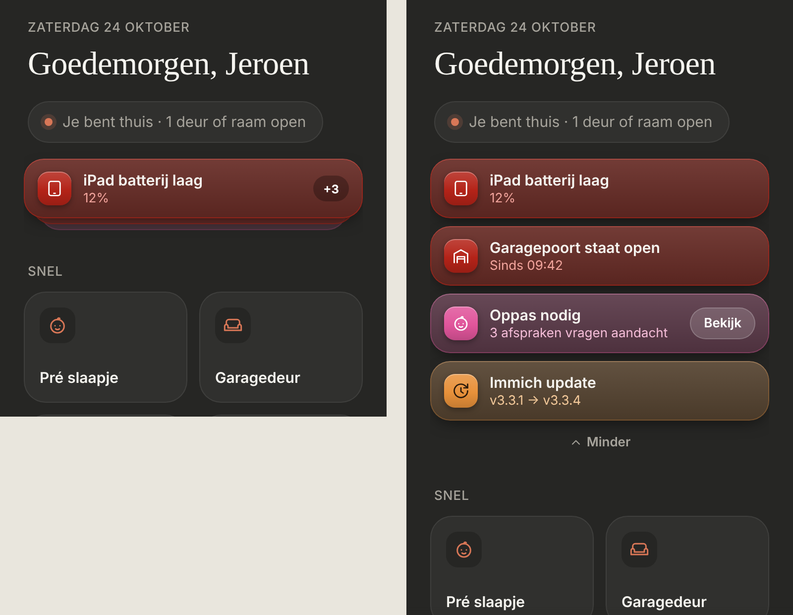

# Warning stack

With two or more warnings, Thuis stacks them instead of listing them all, so "Snel" stays in view. Dark mode only. Builds on the [warnings](../attention-banner/README.md).

> ✅ **Approved and built (option A).** Don't change proportions or behaviour without asking first.
>
> Code: `Attention` in `src/components/Attention.tsx`, styles under "Stack" in `src/styles.css`.

Source: [`mockup.html`](./mockup.html). As built (dev mode, mock data with four warnings), stacked and opened:

## Behaviour

- **One warning:** a normal banner, as before. No badge, no stack.
- **Two or more, stacked:** the most important warning in front (same order as the list), with **"+N"** on the right for the warnings behind it. Up to two narrower cards peek out underneath, each in its own warning's colour.
- **Tap the stack:** all warnings in a list, exactly like before.
- **"Minder"** (centred, under the list) stacks them again. Opening the app again starts stacked; nothing is remembered.
- **"Bekijk"** on the front warning still opens that warning's sheet; it doesn't open the list.

## Not chosen

- **B · the stack opens a sheet** with all warnings.
- **C · one summary row** ("4 waarschuwingen" with a coloured dot per warning) that opens the sheet: the calmest, but you can't see what's wrong without tapping.
