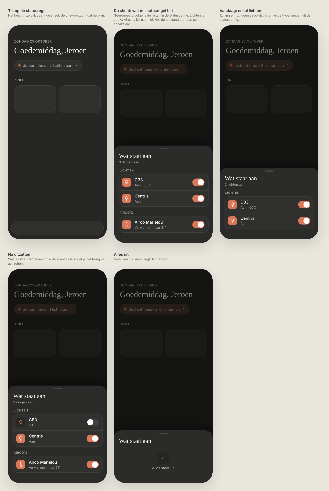
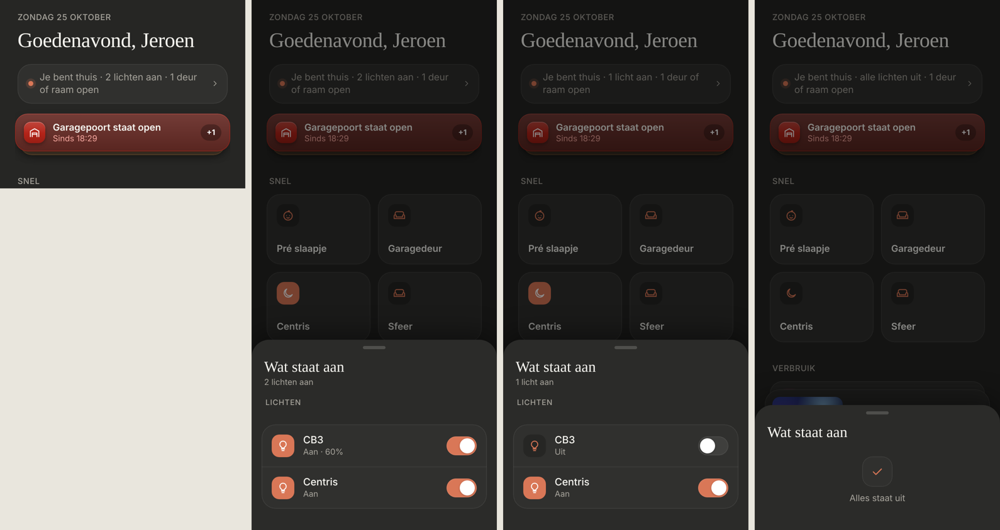

# Wat staat aan

Tapping the status line on Thuis opens a sheet with what's on, each with a switch to turn it off. Dark mode only. Nothing fancy: no options, no extra controls.

> ✅ **Approved and built.** Don't change proportions or behaviour without asking first.
>
> Code: `WhatIsOnSheet` in `src/components/WhatIsOnSheet.tsx`, the groups (`WHAT_IS_ON_GROUPS`) in `src/lib/houseStatus.ts`, the tappable status line in `Header.tsx`.

Source: [`mockup.html`](./mockup.html). The first round (grouped per room or per type): [`options.png`](./options.png). As built (dev mode, mock data): the status line, the sheet, after turning one off, and reopened with everything off:

## Opening it

- **The whole grey status box** is tappable, with a small chevron on the right. The Waze link inside it (docs/design/commute) still opens Waze, not the sheet.

## The sheet

- **Only what the status line counts as on,** nothing else: the entities in the lists of `src/config/status.ts`. That's `lights` and `aircos`. Doors and windows count in the status line, but can't be switched off, so they're not listed.
- **Grouped by the list they're in:** "Lichten" and "Airco's". No room config needed.
- **Each row:** the icon, the name (`name` in the status config, otherwise HA's `friendly_name`), its state ("Aan · 60%", as in the rooms), and a switch. Tapping the row toggles it.
- **Under the title:** how many are still on: "2 lichten aan" with one group, "3 dingen aan" with more.
- **An airco** counts as on in any mode but `off`; its second line is the room's ("Verwarmen naar 21°"), its switch turns it off from any mode.
- **What you turn off stays** in the list, with "Uit", until you close the sheet, so you can turn it back on. Next time it's gone.
- **Nothing on:** the shared empty state, "Alles staat uit" ([empty-state](../empty-state/README.md)).
